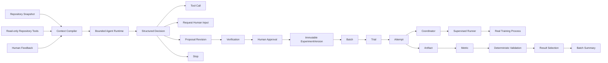

# LabPilot

> **A controllable, recoverable, and verifiable AI Agent Runtime / Harness for machine-learning experiments.**

[](https://github.com/Air000000/LabPilot/actions/workflows/ci.yml)

LabPilot focuses on a concrete problem: **LLMs are probabilistic, while long-running experiments have real cost, side effects, recovery requirements, and reproducibility constraints.**

Instead of letting a model directly control training processes, LabPilot puts the model inside a bounded runtime and separates **agent decisions**, **human approval**, **physical execution**, **recovery**, and **result validation**.

```text
Repository
  -> Proposal
  -> Verification
  -> Human Approval
  -> Immutable ExperimentVersion
  -> Batch / Trial / Attempt
  -> Real Training
  -> Recovery / Reconciliation
  -> Artifact / Metric / Validation
  -> Result Selection
  -> Batch Summary
```

## Why LabPilot

A useful experiment agent has to solve more than prompt generation:

- an LLM can emit malformed or unsafe actions;
- an approved experiment must keep the same code, data, environment, and validation semantics when it is executed;
- a coordinator restart must not blindly launch the same expensive training job again;
- an unknown external execution result must be reconciled instead of guessed;
- a completed process is not automatically a valid scientific result.

LabPilot therefore treats the LLM as a **bounded decision-maker**, not as the source of truth for execution or result validity.

## Architecture



## Core capabilities

### 1. Agent Harness & Context Engineering

LabPilot uses a **bounded Agent Loop** rather than allowing unrestricted model actions.

The runtime compiles repository state, prior tool results, and human feedback into a controlled context, then constrains every model step with:

- a structured decision schema;
- versioned Tool Contracts and JSON Schema validation;
- bounded repository paths and read-only repository tools;
- single-step / single-decision semantics;
- step, model-call, token, and wall-clock budgets;
- **persist-before-execute**: a validated decision is persisted before tool execution or proposal materialization.

The current decision surface is intentionally small:

```text
Tool Call | Request Human Input | Proposal | Stop
```

This keeps model authority explicit and makes state transitions auditable and recoverable.

### 2. Experiment governance & reproducibility

A model-generated proposal is not directly executable.

LabPilot uses the following governance chain:

```text
Proposal Revision
  -> Verification
  -> Human Approval
  -> Immutable ExperimentVersion
```

The approved experiment version binds the execution semantics needed for reproducibility, including the repository snapshot, dataset, environment expectations, parameterization, metrics/artifacts, and validation protocol.

Parameter matrices and random seeds are expanded into stable **Batch / Trial / Attempt** execution identities so that proposal semantics, physical execution, and later results can be traced through the same experiment lineage.

### 3. Reliable long-running execution

Long-running training creates a classic control-plane problem: after a crash or network failure, the coordinator may not know whether a physical launch actually happened.

LabPilot handles this with three core mechanisms:

1. **Persistent Launch Intent** - persist the frozen launch specification and launch intent before crossing the external Runner boundary.
2. **Stable Execution Identity** - the Runner receives a stable physical execution identity instead of a new identity on every retry.
3. **Coordinator Reconciliation** - startup and periodic scans observe physical state and reconcile it with persisted control-plane state instead of blindly relaunching.

Retry and cancellation are explicit state-machine operations rather than generic exception retries.

In fault-injection acceptance testing, a Coordinator restart was reconciled back to the original training attempt **without a second physical launch**. The execution path also covers cancellation of both already-running and not-yet-launched work.

> LabPilot does **not** claim a global "exactly-once" execution guarantee. The design goal is narrower and testable: persist intent before side effects, use stable identities, and reconcile uncertain outcomes instead of replaying them blindly.

### 4. Result Validation & Traceability

A process exiting successfully is not enough to declare an experiment valid.

LabPilot closes the result side with a deterministic result chain:

```text
Artifact
  -> Metric
  -> Validation
  -> Result Selection
  -> Batch Summary
```

The Result Plane records artifacts and metric observations, evaluates deterministic validation rules such as artifact existence and metric finiteness, selects the formal result for a Trial, and produces versioned Batch summaries.

This intentionally separates two kinds of reasoning:

- **probabilistic Agent decisions** for proposing and navigating an experiment;
- **deterministic validation** for deciding whether scientific outputs satisfy the declared protocol.

Runtime Events and SSE-backed read paths provide traceability and replay for execution and result state.

## Key design decisions

| Decision | Rationale |
|---|---|
| Bounded Agent Runtime instead of unrestricted autonomy | Expensive experiments have real side effects; authority must be explicit before increasing agent autonomy. |
| Single-step / single-decision model loop | Keeps each model transition observable, budgeted, and recoverable. |
| Persist decision before execution | Avoids losing the authoritative decision while a later side effect has already happened. |
| Human approval before immutable ExperimentVersion | Separates model suggestions from the experiment that is actually authorized to run. |
| Launch intent before Runner launch | Gives recovery logic a durable fact to reconcile after crashes or uncertain external outcomes. |
| Stable execution identity | Lets retries/recovery refer to the same physical execution rather than accidentally creating a new one. |
| Deterministic Result Validation | Experiment validity should be reproducible and auditable instead of depending on a free-form LLM judgment. |

## Runtime components

- **FastAPI control plane** - experiment, proposal, execution, query, and event APIs.
- **PostgreSQL** - authoritative state, identities, command receipts, events, and result records.
- **Coordinator** - preparation, admission, execution control, recovery, cancellation, and reconciliation.
- **Runner** - isolated physical-process boundary for real training workloads.
- **Repository observation layer** - bounded, read-only repository access used by the Agent Harness.
- **Runtime Events / SSE** - state trace and replay surfaces.

## Quick start

### Requirements

- Python **3.12**
- Docker / Docker Compose
- PostgreSQL **16** (provided by Compose for local development)
- `uv` for the repository development workflow
- A Linux/systemd Runner host for the full real-training execution path

### Start the local API control plane

```bash
docker compose up --build postgres migrate api
```

Then verify readiness:

```bash
curl http://127.0.0.1:8000/health/ready
```

The full training path additionally uses the resident Coordinator and the dedicated Runner host. See:

- [`compose.yaml`](compose.yaml)
- [`scripts/install_labpilot_runner_host.sh`](scripts/install_labpilot_runner_host.sh)
- [`deploy/systemd/labpilot-runner.service`](deploy/systemd/labpilot-runner.service)

## Development and verification

The local-equivalent CI gate is:

```bash
./scripts/check_ci.sh
```

It verifies locked dependencies and historical dependency manifests, then runs:

- Ruff;
- strict mypy;
- unit and architecture tests;
- PostgreSQL integration tests;
- dependency-guard shell tests.

GitHub Actions runs the same gate and additionally verifies the production Docker image/runtime assumptions.

## Scope and boundaries

LabPilot V1 deliberately prioritizes **correctness, recovery, no-duplicate execution, reproducibility, and deterministic result closure** over feature breadth.

The current core is not intended to be:

- a generic multi-agent framework;
- an unrestricted autonomous research agent;
- a generic workflow engine;
- a claim of production-scale horizontal scheduling or global exactly-once semantics.

Those are separate scaling problems. The V1 design first establishes the invariants required to let an LLM safely participate in long-running experiment execution.

## Documentation

Detailed architecture, accepted invariants, implementation plans, ADRs, and acceptance evidence remain under [`docs/`](docs/).

Useful entry points include:

- [`DOCUMENT-STATUS.md`](DOCUMENT-STATUS.md) - document authority and status map;
- [`docs/labpilot/`](docs/labpilot/) - architecture and implementation documents;
- [`docs/superpowers/specs/`](docs/superpowers/specs/) - focused design specifications and ADRs;
- [`docs/superpowers/evidence/`](docs/superpowers/evidence/) - acceptance and failure-injection evidence.

The top-level README is intentionally a project overview; historical frozen plans and integrity manifests remain in the documentation tree for traceability.

## Technology

**Python 3.12 · FastAPI · PostgreSQL · SQLAlchemy · Pydantic · Alembic · Docker Compose · systemd · Pytest · Ruff · mypy · SSE**
