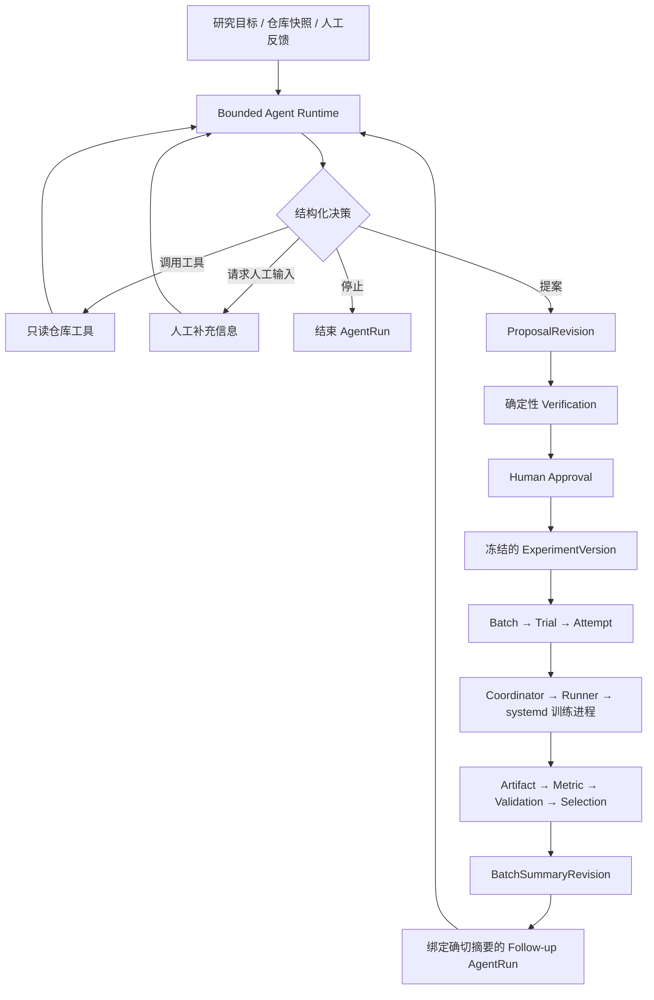
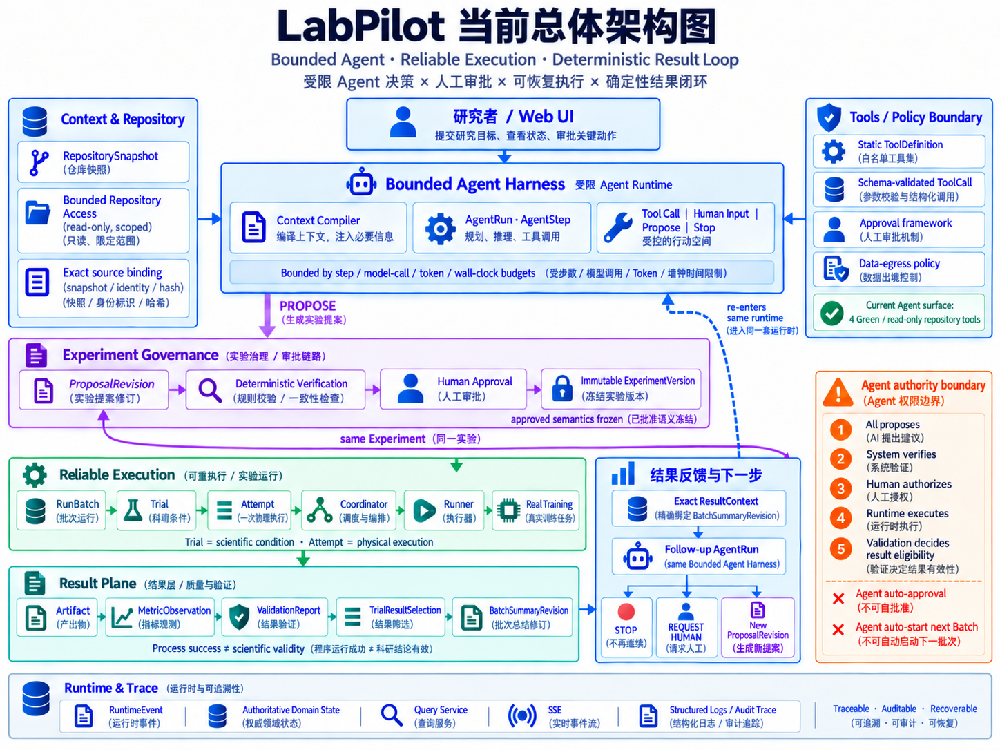
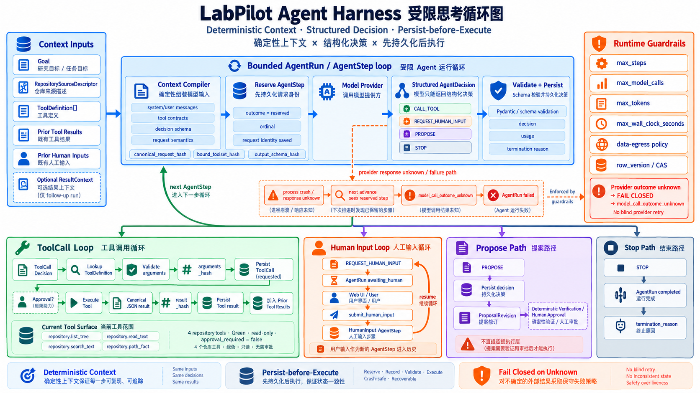
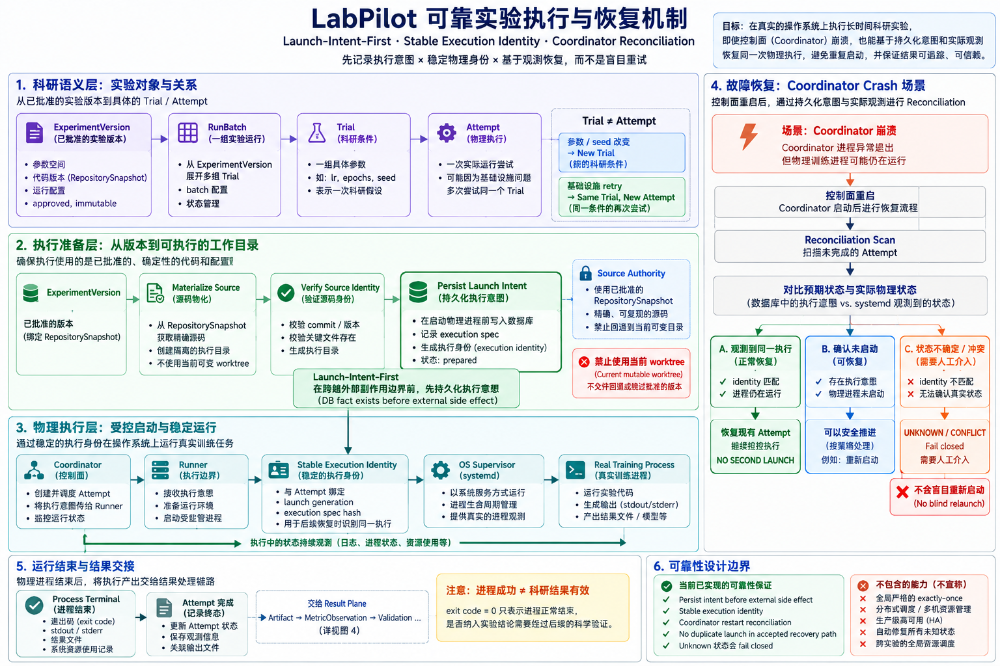
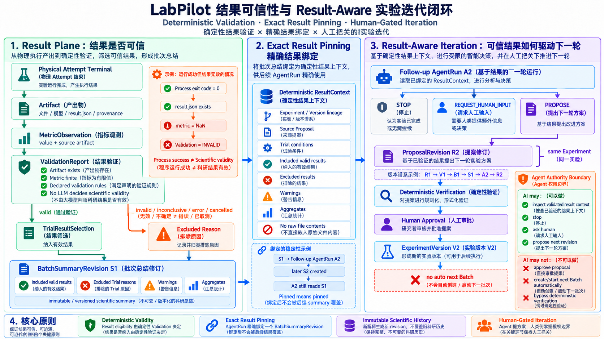

# LabPilot

**面向科研实验的 Agent Runtime / Harness：将研究意图、批准的实验版本、真实执行和验证后的结果，组织成可追溯的实验血缘。**

[](https://github.com/Air000000/LabPilot/actions/workflows/ci.yml)

科研项目反复迭代后，方案、代码、参数、seed、checkpoint 和指标容易分散在不同目录与记录中。即使找到了一个结果，也未必能完整回答：这个实验为什么运行，当时批准了什么，失败后是否重跑，哪个物理进程产生了结果，以及为什么最终采用这份结果。

LabPilot 将这些关系建模为持久化状态。Agent 负责理解目标、读取证据和提出实验方案；系统负责语义检查、人工审批、物理执行、故障恢复与结果验证。实验完成后，Agent 可以基于精确绑定的结果摘要提出下一轮修订。

贯穿系统的原则是：**概率性的模型输出和不确定的外部响应，必须经过检查、身份绑定或持久化证据，才能成为后续动作的依据。**

## 1. 实验血缘与整体架构

```text
Research Goal
  → ProposalRevision
  → Verification
  → Human Approval
  → ExperimentVersion
  → Batch / Trial / Attempt
  → Real Training
  → Artifact / Metric / ValidationReport
  → TrialResultSelection
  → BatchSummaryRevision
  → Exact ResultContext
  → Follow-up AgentRun
  → Stop / Request Human Input / 同一 Experiment 的下一版 Proposal
```

这条链将实验中的三类职责分开：

| 职责 | 主要组件 | 负责的问题 |
|---|---|---|
| 开放式决策 | ContextCompiler、Bounded Agent Runtime、只读仓库工具 | 根据目标与证据，下一步做什么 |
| 实验治理与执行 | Verifier、Approval、ExperimentVersion、Coordinator、Runner | 哪一版实验获准执行，实际执行是否与记录一致 |
| 结果与迭代依据 | Artifact、Metric、Validation、Selection、Summary、ResultContext | 哪些结果满足声明协议，下一轮依据哪版结果 |



当前实现按领域划分 Python 模块。API、常驻 Coordinator 与宿主机 Runner 具有不同运行职责；PostgreSQL 保存权威领域状态。图中的业务模块不对应同等数量的独立微服务。

## 2. Bounded Agent Runtime：受约束的决策循环

### 上下文与决策空间

每个 AgentRun 由一系列持久化 AgentStep 构成。ContextCompiler 在调用模型前，组合研究目标、绑定的 RepositorySnapshot 描述、工具契约、历史工具结果和人工输入；后续运行还会加入绑定的 ResultContext。

模型每一步只能返回一个符合 schema 的结构化决策：

| 决策 | Runtime 的行为 |
|---|---|
| `call_tool` | 校验工具及参数，记录调用，再执行工具 |
| `request_human_input` | 进入等待状态；人工回答作为新的步骤进入历史 |
| `propose` | 将实验方案物化为 ProposalRevision，结束本次 AgentRun |
| `stop` | 结束运行并记录原因 |

当前注册给 Agent 的工具只有四个：

```text
repository.list_tree    查看仓库目录
repository.read_text    读取文件片段
repository.search_text 搜索文本
repository.path_fact   查询路径事实
```

这些工具均为 Green / read-only，在构造时绑定 RepositorySnapshot。工具参数不能替换为任意宿主机目录；路径、读取大小和返回数量均有边界。Tool Policy 已有风险分类与审批基础，但当前 Agent 工具集合没有代码写入、shell、实验审批或训练启动能力。

### Persist-before-execute

```text
检查运行状态、预算和数据出境策略
→ 编译模型上下文
→ 持久化 AgentStep(reserved) 与请求身份
→ 调用 Model Provider
→ 校验结构化 AgentDecision
→ 持久化 decision、usage 和运行状态
→ 执行工具 / 等待人工 / 物化提案 / 结束
```

一次调用保存 `canonical_request_hash`、`bound_toolset_hash` 和 `output_schema_hash`，用于核对模型当时依据的输入及契约。相同绑定输入可以得到相同的规范化请求；模型输出仍具有概率性。

如果控制进程在模型调用期间崩溃，再次推进时发现遗留的 `reserved` 步骤，Runtime 会以 `model_call_outcome_unknown` 结束运行，不假定请求从未发生。若提案决策已经持久化、提案物化尚未完成，则可以根据已保存的决策继续，并复用同一提案修订。

运行预算包括 steps、model calls、tokens 和 wall-clock time；并发状态更新使用 `row_version` 检查。Token 预算按 provider 返回的 usage 计账并停止后续动作，不是供应商计费侧的绝对上限。远程 provider 还受数据出境策略控制，仓库工具只读并不意味着读取内容不会被发送给模型服务。

实现：[Agent 循环](src/labpilot/agent_runtime/service.py) · [ContextCompiler](src/labpilot/agent_runtime/context_compiler.py) · [仓库工具](src/labpilot/tools_policy/repository_tools.py)

## 3. Proposal Governance：批准精确的实验语义

Agent 生成的 Proposal 描述实验目标、训练入口、工作目录、参数矩阵、seed、数据集引用、环境要求、产物、指标、验证规则、超时和重试策略。它随后经过两道独立检查：

**Deterministic Verification** 检查可执行契约，包括快照是否属于当前项目且为 clean、身份是否一致、入口和目录是否存在、参数与 seed 是否合法、argv 模板是否消费全部参数、产物与指标及验证规则是否对应。数据集检查包含声明的稳定身份与可复现级别，环境检查包含契约约束；这些检查不替代对任意外部数据源内容的实际核验。

**Human Approval** 决定是否授权这一版实验。审批记录绑定 Proposal payload hash、Verification、RepositorySnapshot ID 与 identity、DatasetReference hash、EnvironmentExpectation hash，以及审批者和时间。生成的 ExperimentVersion 进一步绑定验证协议，冻结已批准的实验语义。

因此，一份针对代码 A、数据声明 A、验证规则 A 的批准，不能被用于另一组实验语义。修改方案需要新的 ProposalRevision 和批准后的 ExperimentVersion，已有版本保持不变。

Repository 层允许对 dirty snapshot 进行分析，但正式 Verification / Approval 要求满足 clean snapshot 等约束。入口是否存在等事实由系统对绑定快照独立检查，不依赖 Agent 的自然语言描述。

实现：[ProposalVerifier](src/labpilot/experiments/proposal_verifier.py) · [审批与版本服务](src/labpilot/experiments/proposal_service.py)

## 4. Batch / Trial / Attempt 与确切源码

### 科研条件与物理尝试分离

| 对象 | 含义 | 示例 |
|---|---|---|
| ExperimentVersion | 一版已批准的实验设计 | 代码、数据引用、环境要求、参数空间及验证协议 |
| Batch | 对该版本的一次批量展开 | 参数矩阵 × seeds 形成一批 Trial |
| Trial | 一个具体的科研条件 | learning_rate=0.005、epochs=1000、seed=7 |
| Attempt | 该 Trial 的一次物理执行尝试 | 首次执行或允许的基础设施重试 |

同一参数与 seed 因基础设施故障重跑，仍属于原 Trial，只增加 Attempt。不同条件属于不同 Trial；代码、数据或验证语义变化则需要新的实验版本。这样可以保留重试历史，而不会把机器重试误算成新的科研样本。重试受基础设施失败允许列表及 `max_retries` 限制。

### Source Materialization

正式 Attempt 根据 ExperimentVersion 绑定的 RepositorySnapshot 物化确切源码，生成 SourceManifest 与 FrozenExecutionSpec。工作目录先在 staging 中准备，再通过 `os.replace` 转为正式 workspace，并重新检查输入绑定及权限。

```text
workspace/
├── source/          训练身份只读的快照源码
└── runtime/
    └── output/     训练输出
```

dispatch 前会再次校验源码身份和内容。开发者随后修改或切换主仓库，不会把已经批准的实验替换成当前 worktree 的代码。

实现：[批次与尝试](src/labpilot/execution/batch_service.py) · [执行准备](src/labpilot/execution/preparation_service.py)

## 5. Reliable Execution：处理不确定的外部副作用

训练启动跨越 PostgreSQL 与操作系统进程管理器，二者不在同一个事务中。最关键的故障窗口是：Runner 可能已经启动训练，但响应丢失或 Coordinator 崩溃。此时直接重发 launch，可能产生第二个物理进程。

LabPilot 使用三个互相配合的机制：

1. **Persist Launch Intent：** 先将 FrozenLaunchSpec、实际环境观测、execution spec hash 和启动意图提交到数据库，Attempt 进入 `launch_pending`，再调用 Runner。
2. **Stable Execution Identity：** 同一 Attempt 使用稳定执行身份，并以 spec hash 检查实际执行是否符合预期。
3. **Reconciliation：** Coordinator 启动时先扫描未完成执行，周期运行时继续对账；根据数据库记录和 Runner / systemd 观测推进状态。

PostgreSQL 保存执行意图和领域记录；Runner / systemd 提供物理状态观测；Coordinator 负责比较与更新，其内存不承担权威状态存储。

### UNKNOWN 与 NOT_FOUND

物理状态不简化为“运行 / 未运行”两个值：

| 观测 | 含义 | 已有启动意图的恢复处理 |
|---|---|---|
| `ACTIVE_MATCH` | 观察到身份与规格匹配的运行实例 | 继续跟踪原 Attempt |
| `TERMINAL_MATCH` | 观察到匹配的终态 | 保存退出码 / 信号等终态事实 |
| `IDENTITY_CONFLICT` | 发现身份或规格冲突 | 标记冲突，要求处理 |
| `NOT_FOUND` | 当前观测路径没有找到执行实例 | 不据此重发 launch；按不确定状态处理 |
| `UNKNOWN` | 证据不足，无法确认状态 | 超过宽限期进入 unknown / attention |

**查询失败不等于任务不存在；没有收到成功响应也不等于操作未发生。**

Runner 的首次启动 preflight 要求 `NOT_FOUND` **且**具备明确的 creation authority，才允许创建 systemd unit。这与 Coordinator 的恢复逻辑不同：已有启动意图时，即便查询返回 `NOT_FOUND`，也不能由此获得再次创建权限。

只有发送前明确失败，或 Runner 明确返回未接受，执行层才能记录 `launch_not_accepted`，再由策略判断是否产生新的 Attempt。对于无法自动证明安全的情况，系统保留不确定性，以部分可用性换取避免错误副作用。

### 取消与终态证据

启动前取消可以直接关闭尚未 launch 的 Attempt。运行中取消则先校验身份，仅对 `ACTIVE_MATCH` 发 stop；身份冲突或状态未知时不会猜测进程归属。

训练退出后，恢复还需要可靠的终态证据。除了当前 supervisor 状态，实现使用 systemd / journald 生命周期信息及 Terminal Receipt，并通过 InvocationID、boot ID 等关联具体执行，处理控制面离线期间任务已经结束的情况。

该机制支持已验证场景中的原 Attempt 恢复和无重复启动；它不提供全局 exactly-once，也不等同于从模型 checkpoint 恢复训练计算。

实现：[执行与对账](src/labpilot/execution/execution_service.py) · [Coordinator](src/labpilot/coordinator/service.py) · [SystemdSupervisor](src/labpilot/execution/systemd_supervisor.py) · [Terminal Receipt](src/labpilot/execution/terminal_receipt.py)

## 6. Result Plane：从进程退出到正式结果

exit code=0 表示程序正常退出，结果仍可能缺失、格式不合法或未达到声明阈值。Result Plane 将执行状态与结果资格分别记录：

```text
Artifact → MetricObservation → ValidationReport → TrialResultSelection → BatchSummaryRevision
```

| 对象 | 保存的信息 |
|---|---|
| Artifact | 来源 Attempt、产物名、相对路径、内容 hash、字节数等 |
| MetricObservation | 来源 Artifact、指标名、split、数值、extractor version |
| ValidationReport | 输入快照、验证协议与处理版本、判定、原因和告警 |
| TrialResultSelection | 被选中的 Trial、Attempt 与 ValidationReport 的关系 |
| BatchSummaryRevision | 入选结果、排除原因、告警、聚合值及摘要版本 |

### 确定性验证与结果资格

验证器按已冻结的协议检查必需产物、指标存在性与有限性、阈值、数据身份声明，以及 Python / framework / CUDA 等实际环境观测，返回 `valid`、`invalid`、`inconclusive` 或 `error`。

只有满足当前协议的 `valid` 结果可以进入正式选择。验证未通过、证据不足和处理错误会保留明确原因；执行失败耗尽和取消也有独立的排除原因。规则验证由代码完成，不使用 LLM Judge。

这里的 `valid` 表示**满足已声明协议**，不是研究假设或科学结论正确性的证明。低于目标阈值的测量也可能具有研究价值，原始记录仍被保存。

### 并发一致性与版本历史

结果处理先加载绑定 Attempt、Trial、Version、数据、环境与验证规则的 contract，再读取产物。准备写入数据库时重新锁定 Attempt 并加载 contract；若与读取前不一致，以 `attempt_authority_changed` 拒绝写入，避免把旧语义下的观测提交为新语义下的结果。

指标和验证记录包含处理版本。同一语义身份下出现冲突不会静默覆盖旧记录；extractor / validator 语义升级可形成新的版本记录。摘要内容变化时追加 BatchSummaryRevision，保留当时的入选范围、解释规则与统计结果。

实现：[提取器](src/labpilot/results_validation/extractor.py) · [验证器](src/labpilot/results_validation/validator.py) · [结果处理](src/labpilot/results_validation/service.py) · [摘要服务](src/labpilot/results_validation/summary_service.py)

## 7. Result-Aware Iteration：让结果成为下一轮依据

当前已实现从持久化结果摘要到后续 AgentRun 的闭环。它复用同一个 bounded runtime，通过 ContextCompiler 注入 ResultContext，不需要给 Agent 新增任意数据库查询权限。

```text
Experiment E
  R1 → Verification → Approval → V1 → B1 → S1
                                            ↓
                                      AgentRun A2
                                            ↓
                           Stop / Request Human Input / R2
                                                         ↓
                                               Verification → Approval → V2
```

### Exact Result Pinning

创建后续运行时，系统在 Batch 行锁下检查所选 Summary 是当时最新修订，并把其 ID 持久化到 AgentRun。之后每一步加载这个确切修订：即使后来生成 S2，已经绑定 S1 的 A2 仍读取 S1。

ResultContext 包含来源 Experiment / Version / Proposal、Trial 条件、入选指标、排除原因、告警和聚合值，不直接注入原始日志或 checkpoint 文件内容。后续原始 MetricObservation 的变化也不会替换已保存摘要中的值。

后续提案进入同一个 Experiment 的新 ProposalRevision，仍需 Verification 与 Human Approval 才产生 V2；系统不会自动创建或启动下一批 Batch。当前还要求同一项目和同一已批准仓库快照，因此已实现的是结果驱动的方案与参数修订，跨实验历史检索和受控代码修改仍属于后续能力。

实现：[精确绑定与上下文读取](src/labpilot/api/result_aware_agent_adapter.py) · [ResultContext](src/labpilot/agent_runtime/result_context.py) · [P1 验收记录](docs/superpowers/evidence/2026-09-22-labpilot-p1-result-aware-iteration-closeout.md)

## 8. 真实实验与恢复验证

Core Demo 使用 Python 标准库实现的 CPU 逻辑回归训练，采用固定 train / validation 划分。参数矩阵为 `learning_rate=[0.0005,0.005]`、`epochs=[100,1000]`、`seeds=[7]`，共 4 个 Trial，目标为 validation accuracy ≥ 0.92。

候选参数和产物契约已在演示仓库中声明，Agent 根据仓库证据形成结构化提案。这个实验验证的是 Agent 与运行系统的完整链路，不承担算法创新或自动最优搜索的证明。

### Golden Path 结果

| learning_rate | epochs | seed | accuracy | 协议判定 | 正式选择 |
|---:|---:|---:|---:|---|---|
| 0.0005 | 100 | 7 | 0.650 | invalid | 否 |
| 0.005 | 100 | 7 | 0.895 | invalid | 否 |
| 0.0005 | 1000 | 7 | 0.895 | invalid | 否 |
| 0.005 | 1000 | 7 | 0.941 | valid | 是 |

四个 Attempt 均正常退出，生成 8 个 Artifact、4 个 MetricObservation、4 个 ValidationReport，最终只有 1 个 TrialResultSelection。Summary 的 accuracy mean 为 `0.941`、count 为 `1`。

这个均值只描述**入选结果集合**，不是四个 Trial 的总体均值，也不能据此推导整体性能提升。更完整的实验比较需要明确纳入范围、多 seed 与统计设计。

### Coordinator 重启验证

另一个 Batch 复用相同的已批准 ExperimentVersion，在训练运行期间仅重启 Coordinator。恢复前后的 Attempt ID、execution identity 和 systemd InvocationID 一致，物理启动次数保持为 `1`，随后原任务自然完成。

| 证据 | 已建立的结论 | 范围 |
|---|---|---|
| [Slice 2 MVP Smoke](docs/superpowers/evidence/2026-08-31-labpilot-slice2-mvp-smoke.md) | 真实执行、Coordinator 恢复、运行中取消与启动前取消 | 单 Coordinator 的有界 MVP |
| [Core Demo Closeout](docs/superpowers/evidence/2026-09-19-labpilot-competition-core-demo-closeout.md) | 真实模型与训练链路完成；单独的恢复 Batch 无重复物理启动 | 绑定基线 `c92bf45`，不扩展为任意故障保证 |
| [P1 Closeout](docs/superpowers/evidence/2026-09-22-labpilot-p1-result-aware-iteration-closeout.md) | 精确结果绑定、同一 Experiment 的新修订、人工审批边界 | 结果驱动迭代已接受并集成 |

每份验收记录绑定自己的版本和场景。Slice 2 production hardening 仍 deferred，Slice 3 的完整最终 native acceptance 也有未关闭边界，详见 [DOCUMENT-STATUS.md](DOCUMENT-STATUS.md)。

## 9. 工程约束与设计取舍

**权限通过依赖边界约束。** API 可以记录用户命令，但不能直接获得物理 launch / reconcile / stop 权限。特权 Runner 模块不反向依赖数据库与业务编排。AST 架构测试扫描这些依赖和调用关系，违反约束会使 CI 失败。

**事件用于追踪，领域表保存权威状态。** RuntimeEvent 和结构化日志保留状态变化；SSE 提供事件续读，页面再查询领域状态。页面回放已有记录，不需要重新调用模型或启动训练。

**复杂度集中在真实故障窗口。** 先持久化意图为恢复提供依据，但数据库与进程管理器仍无共同事务；未知状态保守停止会降低部分可用性。当前采用单 Coordinator、Linux/systemd Runner，尚未建立多机资源调度或所有故障组合的生产保证。

**模型能力与系统正确性分别评价。** ScriptedProvider 测试用于验证状态契约与权限边界；真实 provider 演示用于验证集成路径。两者都不能替代跨任务的提案质量评估，目前没有研究者生产效率提升的量化结论。

后续重点是接入更多真实实验、建立提案通过率与人工修改量等评估，补齐结构化历史比较及必要的恢复硬化。受控代码修改需要独立的隔离工作区、检查和审批流程；当前核心未开放此能力。

## 10. 架构参考图

以下图片用于展示模块关系，精确状态与行为以正文及实现为准。图中的“确定性”指输入、记录或规则计算，不代表模型决策确定；“科学有效性”限定为声明协议下的结果资格。NaN 在当前 JSON 提取路径中被拒绝并形成 `error`，未必进入图示的 `invalid` 路径；启动意图提交后的实际状态为 `launch_pending`，恢复中的 `NOT_FOUND` 不授予重新启动权限。

<details>
<summary>总体架构</summary>



</details>

<details>
<summary>Agent Harness</summary>



</details>

<details>
<summary>可靠执行与恢复</summary>



</details>

<details>
<summary>Result Plane 与实验迭代</summary>



</details>

## 11. 运行与开发

**技术栈：** Python 3.12 · FastAPI · PostgreSQL 16 · SQLAlchemy · Pydantic · Alembic · systemd · Docker Compose · Pytest · Ruff · mypy · SSE。

### 演示应用

已有演示部署提供 [实验操作台](http://127.0.0.1:18001/operator)、[运行记录](http://127.0.0.1:18001/ops) 和 [就绪检查](http://127.0.0.1:18001/health/ready)。操作台支持目标输入、Agent 轨迹、提案验证、批准、实验启动、结果查看与后续轮；记录入口可以回放持久化历史。

[演示启动脚本](scripts/start_interview_operator_demo.sh) 面向已配置的开发机，依赖预建数据库、Runner、用户权限和私有 provider 配置；当前操作台绑定固定演示项目 / 快照。新部署需要先完成这些配置，不能将此脚本视为通用安装程序。

### 开发部署

参考 [.env.example](.env.example) 配置数据库、仓库允许根、workspace、宿主机 UID / GID 和 provider 策略。完整训练路径还需要安装 [Runner 服务](deploy/systemd/labpilot-runner.service)，入口为 [安装脚本](scripts/install_labpilot_runner_host.sh)。

完成配置和宿主机目录准备后，可按 [compose.yaml](compose.yaml) 启动控制面与 Coordinator：

```bash
docker compose up --build postgres migrate api coordinator
curl -fsS http://127.0.0.1:8000/health/ready
```

默认 provider 出境策略为 `local_only`；使用远程 provider 需要显式配置。API ready 表示数据库与迁移就绪，完整训练还取决于 Runner 及执行环境。

### 测试与源码入口

本地等价 CI 入口为：

```bash
./scripts/check_ci.sh
```

该脚本检查锁定依赖、历史依赖清单、Ruff、mypy、单元 / 架构测试、PostgreSQL 集成测试及 shell guard。集成测试需配置独立的 `LABPILOT_TEST_ADMIN_DATABASE_URL`，fixture 使用具有创建和删除测试数据库权限的账户建立隔离数据库。

| 不变量 | 测试入口 |
|---|---|
| 模型调用前保留步骤、未知响应不补调、提案物化重入 | [Agent Runtime 单测](tests/unit/agent_runtime/test_agent_service.py) |
| 方案事实校验与审批前约束 | [ProposalVerifier 单测](tests/unit/experiments/test_proposal_verifier.py) |
| 物理启动、对账与取消 | [执行服务集成测试](tests/integration/test_attempt_execution_service.py)、[Coordinator 集成测试](tests/integration/test_coordinator_reconciliation.py) |
| 结果 JSON、指标有限性与阈值 | [提取器单测](tests/unit/results_validation/test_extractor.py)、[验证器单测](tests/unit/results_validation/test_validator.py) |
| 后续运行固定读取摘要、不受后续原始指标变化影响 | [精确绑定集成测试](tests/integration/agent_runtime/test_follow_up_run_binding.py) |
| R2 / V2 的形成与禁止自动创建下一批 | [两轮闭环测试](tests/integration/p1/test_result_aware_iteration.py) |
| API 与特权执行边界 | [架构测试](tests/architecture/test_execution_privilege_boundary.py) |

详细设计、实现状态与验收记录：[文档状态](DOCUMENT-STATUS.md) · [领域架构](docs/labpilot/) · [设计与 ADR](docs/superpowers/specs/) · [验收证据](docs/superpowers/evidence/)。
