# LabPilot

> **An AI-assisted experiment runtime that turns research goals, experiment versions, physical executions, and results into a traceable experiment lineage.**

[](https://github.com/Air000000/LabPilot/actions/workflows/ci.yml)

LabPilot starts from a practical research problem: as experiments accumulate, the researcher is often left with many proposal variants, parameter/seed branches, checkpoints, logs, and metrics, while the relationships between **why an experiment was proposed, which version was approved, what was actually executed, and which result was ultimately trusted** become increasingly difficult to reconstruct.

The goal is to make that research trajectory explicit and durable. LabPilot persists proposal revisions, approvals, immutable experiment versions, execution identities, physical attempts, artifacts, metrics, validations, and formal result selections so that an experiment can be traced from its research goal to its final result.

The Agent participates on top of that lineage: it can inspect bounded repository context, incorporate prior tool results and human feedback, and—after a Batch closes—reason from an exact persisted result summary to help revise the next experiment proposal. The runtime and recovery mechanisms exist to make that assistance safe and reproducible rather than to turn the model into an unrestricted source of execution truth.

```text
Research Goal
  -> Proposal Revision
  -> Verification
  -> Human Approval
  -> Immutable ExperimentVersion
  -> Batch
  -> Trial (parameter / seed branch)
  -> Attempt (physical execution intent)
  -> Real Training
  -> Artifact / Metric / Validation
  -> Result Selection
  -> Batch Summary
  -> Exact ResultContext
  -> Follow-up AgentRun
  -> Stop | next Proposal Revision in the same Experiment
```

## Why LabPilot

In an iterative research project, the difficult part is often not launching one more training command. The difficult part is preserving enough context to answer questions later:

- Why was this experiment run in the first place?
- Which proposal revision and repository state did it come from?
- Which code, data, environment expectations, parameters, and validation rules were actually approved?
- Which parameter/seed branch produced this Trial?
- Was a later Attempt a new scientific trial or only an infrastructure retry?
- Which physical process produced a checkpoint or metric?
- Which result passed the declared validation protocol and became the formal result?
- What evidence should inform the next experiment revision?

Without an explicit lineage, those answers tend to be scattered across shell history, directories, checkpoints, logs, spreadsheets, and human memory. LabPilot's V1 models the path from **proposal goal -> approved version -> logical trial -> physical attempt -> validated result** as durable state.

This is the product motivation. The reliability mechanisms described below solve a second-order problem: once an AI Agent is allowed to participate in that workflow, its probabilistic decisions must not make the experiment record less trustworthy.

> **Current evidence boundary:** LabPilot does not claim a measured reduction in researcher time or a production-scale productivity improvement. The current V1 claim is narrower: it establishes a traceable, recoverable, and verifiable experiment lineage that can support later analysis and iteration.

## Architecture

```mermaid
flowchart LR
    Goal[Research Goal] --> Ctx[Context Compiler]
    Repo[Repository Snapshot] --> Ctx
    Tool[Read-only Repository Tools] --> Ctx
    Human[Human Feedback] --> Ctx

    Ctx --> Agent[Bounded Agent Runtime]
    Agent --> Decision[Structured Decision]
    Decision --> ToolCall[Tool Call]
    Decision --> HumanInput[Request Human Input]
    Decision --> Proposal[Proposal Revision]
    Decision --> Stop[Stop]

    Proposal --> Verify[Verification]
    Verify --> Approval[Human Approval]
    Approval --> Version[Immutable ExperimentVersion]

    Version --> Batch[Batch]
    Batch --> Trial[Trial]
    Trial --> Attempt[Attempt]
    Attempt --> Coordinator[Coordinator]
    Coordinator --> Runner[Supervised Runner]
    Runner --> Training[Real Training Process]

    Attempt --> Artifact[Artifact]
    Artifact --> Metric[Metric]
    Metric --> Validation[Deterministic Validation]
    Validation --> Selection[Result Selection]
    Selection --> Summary[Batch Summary]
    Summary --> ResultCtx[Exact ResultContext]
    ResultCtx --> FollowAgent[Follow-up AgentRun]
    FollowAgent --> FollowDecision{Stop / Human Input / Proposal}
    FollowDecision --> FollowStop[Stop]
    FollowDecision --> FollowHuman[Request Human Input]
    FollowDecision --> Proposal
```



## Core capabilities

### 1. Research lineage and experiment governance

LabPilot treats experiment history as a first-class system concern rather than as a directory of outputs.

A proposal revision persists the experiment `goal` together with the repository snapshot and execution/validation semantics. The proposal then moves through:

```text
Proposal Revision
  -> Verification
  -> Human Approval
  -> Immutable ExperimentVersion
```

The approved `ExperimentVersion` freezes the semantics needed to later explain and reproduce the experiment, including repository identity, dataset reference, environment expectations, parameterization, declared metrics/artifacts, and validation protocol.

Parameter matrices and random seeds are expanded into stable **Batch / Trial / Attempt** identities:

- **Batch** groups one execution expansion of an approved experiment version;
- **Trial** represents one logical parameter/seed branch;
- **Attempt** represents a physical execution attempt for that Trial.

This separation keeps research intent, approved design, logical experiment branches, physical execution, and later results connected without collapsing them into one opaque "run" record.

### 2. Agent-assisted experiment iteration

The Agent is intended to help the researcher reason about and revise experiments, not to replace the authoritative experiment record.

LabPilot uses a **bounded Agent Loop**. The runtime compiles repository state, prior tool results, and human feedback into controlled context, then constrains each model step with:

- a structured decision schema;
- versioned Tool Contracts and JSON Schema validation;
- bounded repository paths and read-only repository tools;
- single-step / single-decision semantics;
- step, model-call, token, and wall-clock budgets;
- **persist-before-execute**: a validated decision is persisted before tool execution or proposal materialization.

The current decision surface is intentionally small:

```text
Tool Call | Request Human Input | Proposal | Stop
```

This lets the Agent inspect evidence and help form the next proposal while keeping model authority explicit and every transition auditable.

After a Batch summary is persisted, LabPilot can start a **Follow-up AgentRun** pinned to that exact `BatchSummaryRevision`. The model receives a bounded deterministic `ResultContext` containing the source experiment/version identities, Trial conditions, selected valid evidence, exclusions, warnings, and aggregates. A follow-up Proposal is created as the next `ProposalRevision` in the **same Experiment**, but it still must pass the existing deterministic verification and explicit human-approval path before a new `ExperimentVersion` exists. The Agent does not automatically approve the proposal or create/start the next Batch.

### 3. Reliable long-running physical execution

Once an approved experiment crosses into real training, LabPilot has to preserve lineage even through crashes and uncertain external outcomes.

A long-running training task creates a control-plane problem: after a coordinator crash or network failure, the system may not know whether the physical launch actually happened. Blindly retrying would create a second process and corrupt the relationship between the recorded Attempt and reality.

LabPilot therefore uses three core mechanisms:

1. **Persistent Launch Intent** - persist the frozen launch specification and launch intent before crossing the external Runner boundary.
2. **Stable Execution Identity** - the Runner receives a stable physical execution identity instead of a new identity on every recovery path.
3. **Coordinator Reconciliation** - startup and periodic scans observe physical state and reconcile it with persisted control-plane state instead of blindly relaunching.

Retry and cancellation are explicit state-machine operations rather than generic exception retries.

In fault-injection acceptance testing, a Coordinator restart was reconciled back to the original training Attempt **without a second physical launch**. The execution path also covers cancellation of both already-running and not-yet-launched work.

> LabPilot does **not** claim a global "exactly-once" execution guarantee. The narrower invariant is: persist intent before side effects, use stable identities, and reconcile uncertain outcomes instead of replaying them blindly.

### 4. Result validation and experiment closure

A directory full of checkpoints and metric files is not yet a usable experiment history. LabPilot closes the lineage with a deterministic result chain:

```text
Artifact
  -> Metric
  -> Validation
  -> Result Selection
  -> Batch Summary
```

The Result Plane records artifacts and metric observations, evaluates deterministic validation rules such as artifact existence and metric finiteness, selects the formal result for a Trial, and produces versioned Batch summaries.

This deliberately separates:

- **probabilistic Agent reasoning** for inspecting context and proposing the next experiment;
- **deterministic validation** for deciding whether scientific outputs satisfy the declared protocol.

Runtime Events and SSE-backed read paths provide traceability and replay across execution and result state. The result lineage can therefore be tied back to the Trial and approved `ExperimentVersion` that produced it rather than existing as an isolated metric.

## Key design decisions

| Decision | Rationale |
|---|---|
| Persist proposal revisions and immutable ExperimentVersions | Preserve why an experiment changed and which exact design was actually authorized. |
| Separate Batch / Trial / Attempt identities | Keep parameter/seed branches distinct from infrastructure retries and physical executions. |
| Bounded Agent Runtime instead of unrestricted autonomy | The Agent should help revise experiments without becoming the source of truth for execution or result validity. |
| Single-step / single-decision model loop | Keeps each model transition observable, budgeted, and recoverable. |
| Persist decision before execution | Avoids losing the authoritative decision while a later side effect has already happened. |
| Human approval before immutable ExperimentVersion | Separates model suggestions from the experiment that is actually authorized to run. |
| Launch intent before Runner launch | Gives recovery logic a durable fact to reconcile after crashes or uncertain external outcomes. |
| Stable execution identity | Lets recovery refer to the same physical execution instead of accidentally creating a new one. |
| Deterministic Result Validation | The formal scientific result should be reproducible and auditable instead of depending on a free-form LLM judgment. |
| Exact result-context pinning | A Follow-up AgentRun reasons from one exact persisted BatchSummaryRevision rather than mutable latest/raw result state. |

## Runtime components

- **FastAPI control plane** - experiment, proposal, execution, query, and event APIs.
- **PostgreSQL** - authoritative experiment lineage, identities, command receipts, events, and result records.
- **Bounded Agent Runtime** - repository-aware and result-aware proposal iteration under explicit tool, budget, provenance, and approval constraints.
- **Coordinator** - preparation, admission, execution control, recovery, cancellation, and reconciliation.
- **Runner** - isolated physical-process boundary for real training workloads.
- **Repository observation layer** - bounded, read-only repository access used by the Agent Harness.
- **Result Plane** - artifacts, metrics, deterministic validation, result selection, and Batch summaries.
- **Runtime Events / SSE** - state trace and replay surfaces.

## Quick start

### Requirements

- Python **3.12**
- Docker / Docker Compose
- PostgreSQL **16** (provided by Compose for local development)
- `uv` for the repository development workflow
- A Linux/systemd Runner host for the full real-training execution path

### Start the local API control plane

```bash
docker compose up --build postgres migrate api
```

Then verify readiness:

```bash
curl http://127.0.0.1:8000/health/ready
```

The full training path additionally uses the resident Coordinator and the dedicated Runner host. See:

- [`compose.yaml`](compose.yaml)
- [`scripts/install_labpilot_runner_host.sh`](scripts/install_labpilot_runner_host.sh)
- [`deploy/systemd/labpilot-runner.service`](deploy/systemd/labpilot-runner.service)

## Development and verification

The local-equivalent CI gate is:

```bash
./scripts/check_ci.sh
```

It verifies locked dependencies and historical dependency manifests, then runs:

- Ruff;
- strict mypy;
- unit and architecture tests;
- PostgreSQL integration tests;
- dependency-guard shell tests.

GitHub Actions runs the same gate and additionally verifies the production Docker image/runtime assumptions.

## Scope and boundaries

LabPilot V1 prioritizes **traceable experiment lineage, correctness, recovery, reproducibility, no-duplicate physical launch in the accepted recovery path, and deterministic result closure** over feature breadth.

The current core is not intended to be:

- a generic multi-agent framework;
- an unrestricted autonomous research agent;
- a generic workflow engine;
- a complete experiment-tracking UI or scientific notebook replacement;
- an automatic self-running next-experiment loop that bypasses verification or human approval;
- a claim of production-scale horizontal scheduling or global exactly-once semantics.

Those are separate product and scaling problems. V1 first establishes a trustworthy experiment lineage and the invariants required for an AI Agent to participate in that lineage without making it less reliable.

## Documentation

Detailed architecture, accepted invariants, implementation plans, ADRs, and acceptance evidence remain under [`docs/`](docs/).

Useful entry points include:

- [`DOCUMENT-STATUS.md`](DOCUMENT-STATUS.md) - document authority and status map;
- [`docs/labpilot/`](docs/labpilot/) - architecture and implementation documents;
- [`docs/superpowers/specs/`](docs/superpowers/specs/) - focused design specifications and ADRs;
- [`docs/superpowers/evidence/`](docs/superpowers/evidence/) - acceptance and failure-injection evidence.

The top-level README is intentionally a product-and-architecture overview; historical frozen plans and integrity manifests remain in the documentation tree for traceability.

## Technology

**Python 3.12 · FastAPI · PostgreSQL · SQLAlchemy · Pydantic · Alembic · Docker Compose · systemd · Pytest · Ruff · mypy · SSE**