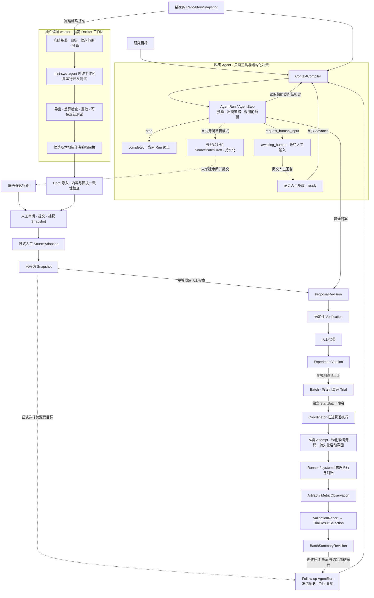

# Research Agent Runtime 总体架构

[公开验收范围](../superpowers/evidence/research-runtime-preview.md) · [中文 README](../../README.md) · [English](../../README.en.md)

[Agent Runtime](../../src/labpilot/agent_runtime/service.py) 将 `stop` 记录为 `completed`。仅 `awaiting_human` 接受匹配版本的人工输入，随后返回 `ready`，由 [advance API](../../src/labpilot/api/routers/agent_runs.py) 继续推进。

普通科研提案使用绑定的源码快照，无需 SourceAdoption。独立 worker 的工作区可写，`editable_paths` 在输出成为候选时约束最终变更范围。独立容器执行冻结的动态检查，Core 核对可信本地操作者提供的回执与候选内容。[独立编码指南](../../tools/coding_worker/README.md#信任边界)说明导入、验收和人工采纳的各自职责。

人工采纳只记录确切候选和新 Snapshot 的关系。采纳后的实验仍须单独提案、校验和人工批准。批准冻结实验版本，[创建 Batch](../../src/labpilot/api/routers/experiments.py) 展开 Trial，[StartBatch](../../src/labpilot/api/routers/execution.py) 单独授权 [Coordinator](../../src/labpilot/coordinator/service.py) 推进 Attempt。Runner 管理物理执行，Coordinator 用稳定身份对账。PostgreSQL 保存权威实验和运行状态。显式绑定已采纳源码的 Follow-up 机制已实现，两次指定真实提案均未通过验收。见[跨源码证据摘要](../superpowers/evidence/research-runtime-preview.md#source-adoption-and-cross-source-follow-up)。

下列图片对应早期 Core Demo 架构，可用于回顾当时的验收基线 `c92bf45`（2026-09-19）。其状态名称和覆盖范围按[历史验收](../superpowers/evidence/2026-09-19-labpilot-competition-core-demo-closeout.md)理解。当前预览的状态与权限以本页、源码及公开证据索引为准。

- [历史总体架构](architecture-overview.png)
- [历史 Agent Harness](agent-harness.png)
- [历史执行与恢复](execution-recovery.png)
- [历史结果迭代](result-loop.png)
