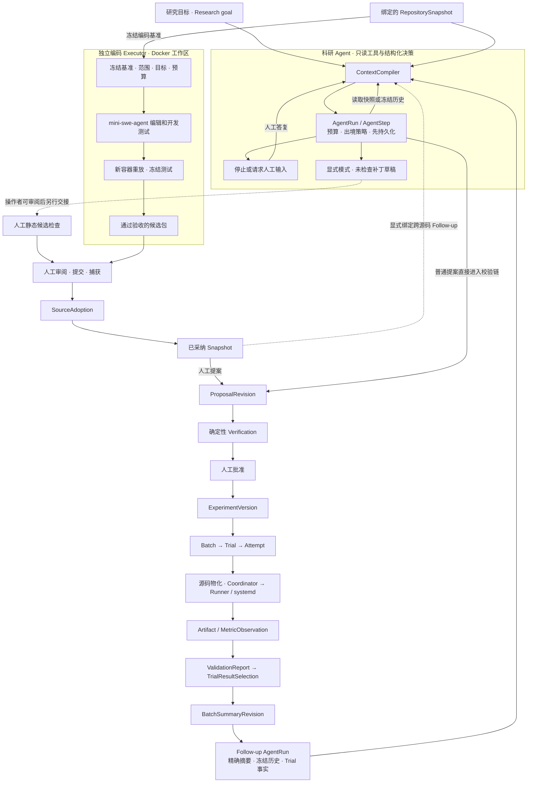

# Research Agent Runtime 总体架构

[公开验收范围](../superpowers/evidence/research-runtime-preview.md) · [中文 README](../../README.md) · [English](../../README.en.md)

科研 Agent 的补丁草稿保留在 AgentStep。独立编码工作区由操作者另行启动。普通科研提案可直接使用已绑定的源码快照，无需 SourceAdoption。源码变更路径经人工采纳记录候选和新 Snapshot 的关系。后续实验仍须单独校验、人工审批和启动，审批绑定确切提案、校验、源码、数据和执行语义。物理进程由 Runner 管理，Coordinator 使用稳定身份对账。PostgreSQL 保存权威实验和运行状态。

下列图片对应早期 Core Demo 架构，可用于回顾当时的验收基线 `c92bf45`（2026-09-19）。其状态名称和覆盖范围按[历史验收](../superpowers/evidence/2026-09-19-labpilot-competition-core-demo-closeout.md)理解。当前预览的状态与权限以本页、源码及公开证据索引为准。

- [历史总体架构](architecture-overview.png)
- [历史 Agent Harness](agent-harness.png)
- [历史执行与恢复](execution-recovery.png)
- [历史结果迭代](result-loop.png)
