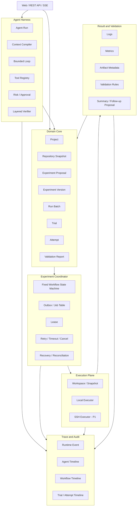

# LabPilot 总体架构蓝图 v0.2

> 文档类型：Master Blueprint / 北极星架构与边界规格  
> 项目定位：以实验为中心的 Research Agent OS  
> 版本：v0.2  
> 状态：待用户评审  
> 日期：2026-07-23  
> 适用对象：个人计算科研场景、求职级工程项目、固定本地/远程服务器环境  
> 目标读者：项目负责人、后续实现者、Codex/Claude Code 辅助开发 Agent、架构评审者

---

## 0. 文档目的、适用层级与修订说明

### 0.1 文档目的

本文是 LabPilot 当前最高层级的设计约束，负责确定：

1. LabPilot 的长期产品定位与当前 V1 边界；
2. 系统服务谁、解决什么真实科研问题；
3. 科研领域状态、Agent Runtime、长期 Workflow、外部 Executor 和结果数据如何分工；
4. 哪些能力必须由 LabPilot 自己掌握，哪些通用能力可以复用成熟库；
5. 哪些内容属于 V1 Core、V1 Differentiator 和未来扩展；
6. 技术选型为何适合“单人开发 + Codex 深度辅助 + 真实科研自用 + 求职展示”；
7. 后续架构规格、阶段规格和实施计划必须遵守的稳定不变量。

本文**不是首版施工清单**，也不定义全部数据库字段、API、页面布局和文件结构。具体实施范围由后续文档约束：

```text
00-master-blueprint-v0.2.md
    长期正确边界 + V1 总体约束

01-v1-scope-and-acceptance.md
    P0 / P1 / P2、非目标、最小实现深度、验收场景

architecture/*.md
    每个核心能力的独立架构规格

phases/phase-*.md
    每个开发阶段的实施规格

implementation-plans/*.md
    Codex 可执行的文件级任务与验证步骤
```

### 0.2 v0.2 相较 v0.1 的核心修订

v0.2 不推翻 v0.1 的状态边界和实验领域模型，但对实施范围做以下收敛：

- 明确区分**长期 Research Agent OS 愿景**与**当前 Experiment-Centric V1**；
- 明确 V1 是个人科研工具和求职项目，不按商业 SaaS、多租户和企业 SLA 设计；
- 保留自研 Agent Harness 的核心语义，但不重写模型协议、SSH、Git、重试等通用底层能力；
- 将 Verifier 改为“确定性验证 → 静态规则 → 可选 LLM 语义复核”的分层机制；
- 将 Local Executor 定为 V1 Core，将 SSH Executor 定为 V1 高价值差异化、但不作为 Core 发布阻塞项；
- 将 Durable Workflow 收缩为实验专用固定状态机，不建设通用 Workflow 平台；
- 将 AgentOps 收缩为统一结构化事件 + 三种查询时间线，不建设三套日志系统；
- 将 Artifact 收缩为来源元数据、文件哈希和可用性记录，不在 V1 建设完整 CAS 与复杂留存体系；
- 新增 P0/P1/P2 优先级原则、V1 运行假设和三类核心验收路径。

### 0.3 证据与决策类型

本文中的判断分为：

- **事实依据**：来自官方文档、固定源码研究卡或已有参考项目分析；
- **架构推断**：结合多个事实与 LabPilot 场景得出的设计结论；
- **项目决策**：在多个可行方案之间，为控制复杂度、保留求职价值和真实使用价值作出的选择。

参考对象包括 Claude Code、Codex、Hermes Agent、OpenHands、MLflow、Temporal、STORM 与 PaperQA2。它们分别提供 Harness、权限、上下文、长期任务、Sandbox、实验遥测、Durable Workflow 和科研信息处理方面的启发，但没有任何一个框架可以直接成为 LabPilot 的完整领域骨架。

---

# 1. 产品定位

## 1.1 长期愿景

> **LabPilot 是面向计算科研的、以实验为中心的持续运行 Research Agent OS。**

长期而言，它应帮助研究者把研究意图持续推进为可审核、可复现、可验证、可追溯的科研产出：

```text
研究问题 / Idea / Baseline
        ↓
项目、代码仓库与历史实验理解
        ↓
可行性检查与正式实验设计
        ↓
受控执行、长期跟踪与故障恢复
        ↓
Metric / Artifact / Result Validation
        ↓
结果解释与下一轮实验
        ↓
未来扩展：Observation / Evidence / Claim / Publication
```

“Research Agent OS”中的 OS 不表示替代操作系统，而表示它提供一套科研实验持续运行所需的控制面：

- 上下文编译；
- Agent 有界决策；
- 工具暴露与风险控制；
- 人工审批；
- 实验领域状态；
- 长期 Workflow；
- 本地和远程执行；
- 结果验证；
- 来源追踪；
- 可回放运行轨迹。

## 1.2 当前 V1 产品

> **LabPilot V1 是 Experiment-Centric Research Agent：从用户已有的研究问题、Idea、Baseline 或代码仓库出发，完成实验规划、受控执行、跨重启恢复、结果验证和下一轮实验提案。**

V1 主链固定为：

```text
已有研究目标 / Idea / Baseline / Repository
        ↓
Project 与 Repository Context
        ↓
Agent 生成 Experiment Proposal
        ↓
确定性检查 + 规则检查 + 可选语义复核
        ↓
研究者批准实验设计
        ↓
冻结 Experiment Version
        ↓
展开 Run Batch / Trials
        ↓
Experiment Coordinator 创建 Attempts
        ↓
Local Executor 执行；SSH 作为后半段增强
        ↓
重试、超时、取消、恢复、对账
        ↓
收集 Logs / Metrics / Artifacts
        ↓
Validation Report
        ↓
Run Batch Summary
        ↓
可选 Follow-up Experiment Proposal
```

## 1.3 当前不解决的问题

V1 不负责：

- 从宽泛领域自动发现研究方向；
- 完整系统综述、Research Gap 与通用 Idea 生成；
- 自动证明 Idea 具有创新性；
- 完整 Evidence Graph、Claim Graph 和论文版本治理；
- 通用多 Agent 社会；
- 通用 Workflow DSL 或 Temporal 替代品；
- GPU/CPU 资源分配和队列调度；
- Kubernetes、Slurm 管理平台或云训练平台；
- 多租户 SaaS、计费、企业 RBAC；
- 企业级高可用与严格 SLA；
- 湿实验与仪器控制。

这些内容可以成为未来扩展，但不得进入 V1 的 P0 依赖链。

---

# 2. 用户、部署与工程假设

## 2.1 首要用户

V1 优先服务：

- 硕士生、博士生和个人计算科研人员；
- 已经拥有研究方向、Baseline、初步 Idea 或代码仓库；
- 使用 Python、Shell、配置文件和命令行完成实验；
- 使用本地 Linux/WSL2 或一台固定 SSH GPU 服务器；
- 同时运行的 Trial 数量有限；
- 希望减少参数混乱、结果误用、失败重跑和实验不可追溯问题。

## 2.2 开发与部署假设

```text
开发者：单人开发，Codex 深度辅助
主要目标：真实科研自用 + 求职展示
用户规模：个人优先，最多扩展到小型课题组
部署形态：本地或私人服务器
并发规模：少量 Batch、少量 Trial
执行环境：Linux / WSL2 + 固定 SSH Linux 服务器
商业化：当前不考虑
公众 SaaS：当前不考虑
企业 SLA：当前不承诺
```

这些假设意味着 V1 不需要提前建设：

- 多租户隔离；
- 组织级 RBAC；
- 计费；
- 分布式消息队列；
- 多区域容灾；
- 企业监控平台；
- 公众生成式 AI 服务合规体系。

## 2.3 V1 价值标准

V1 的价值不以模块数量衡量，而以以下四件事是否真实成立衡量：

```text
受控 Agent 决策
+ 真实实验执行
+ 跨重启可靠恢复
+ 可验证且可追溯
```

---

# 3. 设计优先级与稳定原则

## 3.1 实施优先级

```text
领域正确性 > 平台完整性
真实实验闭环 > 通用功能覆盖
可恢复性 > 高并发
可解释性 > 自动化程度
确定性验证 > LLM 判断
单条深链可信 > 多条浅链可演示
```

## 3.2 稳定架构原则

### P1. 领域事实不能由聊天记录恢复

Conversation、Prompt 和 Agent Run 是输入与执行轨迹，不是 Project、Experiment、Trial 或 Result 的权威来源。

### P2. Agent 产生 Proposal，不直接制造正式事实

Agent 可以生成 Experiment Proposal、修复建议、Summary 和 Follow-up Proposal；正式 Experiment Version 需要研究者确认。

### P3. Agent Run 必须有界

Agent 负责当前目标下的理解、规划、工具调用和提案。训练持续数小时期间，Agent Run 不应保持常驻。

### P4. 长期过程交给 Experiment Coordinator

Coordinator 负责等待、重试、超时、取消、恢复和对账；Executor 负责执行真实进程。

### P5. Trial 与 Attempt 必须分离

- 参数、seed、代码、数据或环境语义变化：新 Trial；
- 相同 Trial 的基础设施重试：新 Attempt。

### P6. 执行成功与实验有效必须分离

```text
exit_code = 0
≠ required artifact exists
≠ metric is valid
≠ trial is scientifically valid
```

### P7. 能由程序验证的内容不交给 LLM

Schema、入口存在性、参数合法性、seed、目录冲突、Artifact 缺失和指标格式由确定性规则处理；语义完整性才交给 LLM Verifier。

### P8. 设计审批与运行授权必须分离

- Experiment Design Approval：确认并冻结科研实验设计；
- Tool Execution Approval：授权一次具体高风险副作用操作。

### P9. Workspace 隔离不等于安全 Sandbox

Worktree 或独立目录解决版本与并发隔离；真正的访问限制由执行 Profile、可写目录和凭据范围控制。

### P10. Runtime Event 用于追踪，不成为业务真相

领域表保存当前权威状态；统一事件记录用于 Timeline、诊断和审计，不实行完整 Event Sourcing。

### P11. 自研核心语义，复用通用协议和底层库

LabPilot 自己掌握 Agent Run、Context Compiler、Bounded Loop、Tool Registry、Approval、Coordinator、Trial/Attempt 与 Validation；模型通信、Structured Output、SSH、Git 和重试库采用成熟实现。

### P12. 模块化单体优先

一个代码库、一个 PostgreSQL、API 与 Worker 两类主要进程，通过明确模块边界协作，不使用微服务增加分布式复杂度。

---

# 4. 总体架构

## 4.1 总体逻辑视图



## 4.2 模块职责

### A. Product Surface

负责 Project、Proposal、Approval、Batch、Trial、Attempt、Validation 与 Timeline 的交互，不承担领域状态推断。

### B. Domain Core

拥有科研实验的权威状态，包括实验设计、版本、逻辑 Trial、物理 Attempt 和验证结果。

### C. Agent Harness

负责构建上下文、执行有界 Loop、选择受控工具、生成 Proposal，并记录 Agent 决策过程。

### D. Experiment Coordinator

负责固定实验生命周期的持久化推进，不建设通用 Workflow 平台。

### E. Execution Plane

负责准备 Workspace、提交和观察本地/远程任务，不决定实验设计是否正确。

### F. Result and Validation

负责收集结果、执行确定性验证、生成结构化 Summary，不自动形成正式科研 Claim。

### G. Trace and Audit

负责将 Agent、Workflow 和 Experiment 三类过程统一关联并呈现，但不替代领域表。

## 4.3 运行进程

V1 建议四类运行单元：

```text
Web UI
FastAPI API
Coordinator / Worker
Executor Process or Adapter
PostgreSQL
Local Artifact Directory
```

Local Executor 可以由 Worker 创建受控子进程；SSH Executor 通过远程 Wrapper 创建可重新识别的 Job。

---

# 5. 状态所有权与不可合并边界

## 5.1 五类权威状态

| 状态域 | 权威对象 | 回答的问题 |
|---|---|---|
| 科研领域状态 | Experiment、Version、Batch、Trial、Validation | 要验证什么，逻辑实验是什么，结果是否有效 |
| Agent Runtime | AgentRun、AgentStep、ToolCall、VerifierResult | Agent 看到了什么、为什么这样行动 |
| Durable Coordination | WorkflowExecution、WorkflowStep、Lease | 长流程目前推进到哪里、何时重试 |
| External Execution | PID、remote_job_id、exit_code、executor observation | 真实进程现在发生了什么 |
| Result Content | Log、Metric、Artifact、hash、availability | 产生了哪些结果，内容在哪里 |

## 5.2 典型合法状态

```text
Agent Run：completed
Workflow：waiting_for_attempt
Remote Job：running
Attempt：running
Trial：executing
```

这是正常状态，而不是数据不一致。

## 5.3 状态同步原则

- Executor observation 先作为观察结果记录；
- Coordinator 根据 observation 推进 Workflow；
- 应用服务根据 Workflow 和 Validation 更新领域状态；
- Agent 只通过受控领域命令提出或触发变更；
- Runtime Event 记录因果关系，但不是状态恢复唯一来源。

---

# 6. 核心领域模型

## 6.1 Project

Project 是当前单用户环境中的科研工作空间，持有：

- 研究目标和项目说明；
- Repository 注册信息；
- Project Manifest；
- Tool/Policy 默认配置；
- Experiment 历史；
- Artifact 根目录和执行 Profile。

V1 不实现复杂 Investigation、团队权限和跨项目 Evidence。

## 6.2 Repository Snapshot

Repository Snapshot 记录 Agent 规划时看到的代码状态：

- repository path / URL；
- branch；
- commit；
- dirty state；
- 关键入口；
- 关键配置文件；
- 项目 Manifest 与 `LABPILOT.md`；
- 生成时间和内容摘要。

它不是完整代码归档。正式执行时的 Code Snapshot 由 Experiment Version/Trial 绑定。

## 6.3 Experiment Proposal

Proposal 是可编辑草案，至少描述：

- 实验目标；
- Baseline 和改动范围；
- 训练/评估入口；
- 参数矩阵；
- seed；
- 数据引用；
- 资源与时间预算；
- 预期 Metric；
- 必需 Artifact；
- Validation 规则；
- 风险动作；
- 可行性检查结果。

Proposal 可以多次修改。批准后生成不可变 Experiment Version。

## 6.4 Experiment Version

Experiment Version 是获批的正式实验设计，绑定：

- Proposal 内容版本或 payload hash；
- Repository/Code Snapshot；
- Parameter Snapshot；
- Dataset Reference；
- Environment Profile；
- Evaluation/Validation Protocol；
- 审批记录。

任何影响实验语义的修改都需要新 Version。

## 6.5 Run Batch

Run Batch 表示一次按 Experiment Version 展开并提交的 Trial 集合。它保存：

- Trial 成员；
- 计划并发；
- Batch 级预算；
- 汇总规则；
- 当前完成进度；
- Batch Summary。

## 6.6 Trial

Trial 表示一个固定实验条件：

```text
Experiment Version
+ parameters
+ seed
+ code snapshot
+ dataset reference
+ environment expectation
```

Trial 不因基础设施失败而改变身份。

## 6.7 Attempt

Attempt 表示 Trial 的一次真实执行，记录：

- attempt number；
- executor type；
- external_job_id / pid；
- workspace；
- submitted/start/end time；
- exit code；
- failure classification；
- stdout/stderr；
- produced Artifact；
- observed environment；
- reconciliation history。

## 6.8 Validation Report

Validation 与执行状态分离。Report 至少回答：

- 命令是否成功结束；
- 是否达到计划步数；
- 必需 Artifact 是否存在；
- Metric 是否可解析、非 NaN；
- Snapshot 是否与预期匹配；
- Trial 是否可纳入 Batch Summary；
- 无效原因是什么。

## 6.9 Summary 与 Follow-up Proposal

Summary 只基于有效 Trial，记录：

- 配置与结果；
- 均值、方差和有效 Trial 数；
- 异常 Trial；
- 执行成本；
- 已知限制。

LLM 可生成 Result Interpretation Proposal 和 Follow-up Experiment Proposal，但它们仍是 Proposal，不是 Accepted Claim。

---

# 7. Agent Harness

## 7.1 自研边界

LabPilot 自己实现：

- `AgentRun`；
- `AgentStep` / `ToolCall`；
- `ContextCompiler`；
- `BoundedLoop`；
- `ToolRegistry`；
- Tool risk metadata；
- Approval decision；
- Termination reason；
- Layered Verifier；
- Runtime Event 与 Context Snapshot。

复用成熟能力：

- OpenAI-compatible / Anthropic 模型客户端；
- Tool Calling 和 Structured Output；
- Streaming 与 token usage；
- JSON Schema；
- Git CLI；
- AsyncSSH；
- Retry/backoff library；
- 日志与序列化基础库。

## 7.2 Bounded Agent Loop

```text
Load Goal
→ Compile Context
→ Plan / Choose Tool
→ Policy Check
→ Execute Tool or Request Approval
→ Observe
→ Verify
→ Continue / Produce Proposal / Ask Human / Stop
```

必须设置：

- 最大 step 数；
- 最大模型调用数；
- 最大 token/cost；
- 最大 wall-clock time；
- 明确终止原因；
- 可恢复 Context Snapshot。

## 7.3 Context Compiler

V1 Context 只组装当前任务必要信息：

```text
用户目标
+ Project Manifest / LABPILOT.md
+ Repository Snapshot
+ 相关 Experiment 历史摘要
+ 当前领域对象
+ Tool / Policy 描述
+ 当前预算与限制
```

V1 不建设通用向量记忆、自动长期记忆学习或复杂多阶段压缩系统。

## 7.4 Layered Verifier

### 第一层：确定性验证

- Schema 完整；
- 入口文件存在；
- 参数合法；
- seed 已设置；
- 输出目录无冲突；
- Metric/Artifact 配置可解析；
- 风险动作已标注。

### 第二层：静态与规则验证

- train/eval 入口是否混淆；
- 参数与配置文件是否一致；
- 环境依赖是否满足；
- 预算、时长和重试是否越界；
- Snapshot 是否完整。

### 第三层：可选 LLM 语义复核

- 实验目标与参数是否匹配；
- 是否遗漏关键对照变量；
- 是否误用历史配置；
- Validation 是否足以回答实验问题。

前两层通过后，才考虑第三层。V1 Core 不依赖第二个常驻 Agent。

## 7.5 Agent 失败降级

Agent 生成非法或低质量 Proposal 时：

- 保留原始 Agent Run；
- 记录 Verifier 失败；
- 允许规则修复或人工编辑；
- 不影响既有 Experiment、Workflow 和 Attempt；
- 不把 Agent 失败升级为系统不可用。

---

# 8. Tools、Policy 与审批

## 8.1 Tool Contract

每个 Tool 至少包含：

- name / version；
- input/output schema；
- risk level；
- required capability；
- timeout；
- idempotency semantics；
- cancellation semantics；
- writable scope；
- credential scope；
- audit metadata。

## 8.2 红黄绿风险分级

### Green：默认允许

- 读取仓库；
- Git 状态检查；
- 读取历史实验；
- 解析日志；
- 读取 Metric/Artifact 元数据；
- 生成 Proposal。

### Yellow：受控环境内允许

- 创建独立运行目录或 worktree；
- 在 Workspace 写配置；
- 安装项目依赖；
- 运行 Smoke Test；
- 启动低成本本地实验；
- 产生临时 Artifact。

### Red：必须审批

- 使用 SSH 凭据；
- 提交远程 GPU 长任务；
- 超过预算阈值；
- 删除或覆盖 Artifact；
- 写主仓库；
- 上传外部服务；
- 访问敏感数据或密钥。

V1 使用静态策略表，不建设通用 Policy DSL。

## 8.3 两类审批

### Experiment Design Approval

批准的是科研实验设计，批准后冻结 Experiment Version。

### Tool Execution Approval

批准的是一次特定高风险 Tool Call，需绑定：

- Tool 名称；
- 规范化参数或 payload hash；
- Project；
- Agent Run；
- 过期时间；
- 是否一次性授权。

两种审批不得共用含糊的业务语义。

---

# 9. Experiment Coordinator

## 9.1 定位

V1 建设的是**实验专用的轻量 Durable Coordinator**，不是通用 Workflow Engine。

## 9.2 固定状态机

```text
await_design_approval
→ prepare_inputs
→ create_trials
→ submit_attempts
→ inspect_attempts
→ collect_results
→ validate_trials
→ finalize_batch
```

失败分支包括：

```text
retry_wait
cancel_requested
manual_intervention
unknown_external_state
failed
```

## 9.3 必须支持的语义

- 状态持久化；
- Transactional Outbox 或等价可靠任务登记；
- Worker Lease；
- Idempotency Key；
- 固定 Retry/Backoff；
- Timeout；
- Cancellation；
- 服务重启恢复；
- Executor Reconciliation；
- 明确 unknown 状态。

## 9.4 明确不建设

- 通用 DSL；
- 用户自定义 DAG；
- Temporal 式 deterministic replay；
- 完整 Event Sourcing；
- 任意 Compensation；
- 分布式 Worker 集群；
- 图形化 Workflow 编辑器。

## 9.5 幂等原则

无法对外部命令承诺严格 exactly-once。V1 目标是：

```text
同一 Attempt 的重复 Coordinator 消息
不得创建第二个可识别的外部 Job
```

通过以下组合降低重复副作用：

- attempt-scoped idempotency key；
- 唯一提交记录；
- 提交前后状态持久化；
- 外部 Job 标识；
- Reconciliation；
- 重复执行检测。

---

# 10. Workspace、Snapshot 与 Executor

## 10.1 P0 Workspace

P0 如果 Agent 只读仓库、只生成配置，则使用：

- 固定只读 Repository；
- 独立 Run Directory；
- 参数和命令快照；
- 输出目录隔离。

## 10.2 P1 Worktree

当 Agent 开始修改实验代码时，Worktree 成为高价值能力：

- 主仓库默认零写入；
- 每个正式实验使用独立 worktree 或源码归档；
- dirty patch 被保存；
- Worktree 仍不等同安全 Sandbox。

## 10.3 Snapshot

V1 最小 Snapshot 包括：

- Code：commit、dirty patch/hash、entrypoint；
- Parameters：规范化 JSON；
- Dataset：路径/URI、版本或 digest；
- Environment：Python、依赖摘要、CUDA/GPU、关键环境变量名；
- Command：工作目录、argv、超时、输出目录。

## 10.4 Executor Interface

```text
prepare()
submit()
inspect()
stream_logs()
cancel()
collect()
cleanup()
```

Executor 返回外部观察，不直接更新科研结论。

## 10.5 Local Executor：V1 Core

必须实现：

- 受控子进程；
- PID/process group；
- stdout/stderr；
- 非零退出；
- timeout；
- cancel；
- 重启后的可恢复检查；
- result collection。

Local 可靠闭环是 V1 Core 的发布阻塞项。

## 10.6 SSH Executor：V1 Differentiator

SSH 不是 P0 发布阻塞项，但属于完整求职版的高价值目标。重点场景不是“远程执行命令”，而是：

```text
提交远程任务并保存 remote_job_id
→ LabPilot 服务停止
→ 远程任务继续
→ 服务恢复
→ 重新查询状态
→ 不重复提交
→ 回收日志和 Artifact
```

V1 只支持固定服务器、固定 Shell Profile 和明确远程 Wrapper，不支持通用集群调度。

---

# 11. Results、Artifact 与 Validation

## 11.1 Artifact 最小模型

V1 保存：

```text
artifact_id
attempt_id
artifact_type
path_or_uri
filename
size
sha256
created_at
availability
```

不建设完整 CAS、自动去重、复杂 Retention 和多区域复制。

## 11.2 Metric

Metric 记录：

- name；
- value；
- step/epoch；
- trial/attempt；
- extractor；
- source artifact/log；
- observed_at。

## 11.3 Validation 顺序

```text
Execution Check
→ Snapshot Check
→ Required Artifact Check
→ Metric Parse Check
→ Domain Rule Check
→ Trial Inclusion Decision
```

LLM 不参与以下确定性判断：

- 文件存在；
- hash；
- step 数；
- NaN；
- JSON/CSV 格式；
- exit code；
- Snapshot 差异。

## 11.4 执行失败与验证失败

示例：

```text
exit_code = 0
required checkpoint missing
```

正确状态是：

```text
Attempt execution = completed
Validation = failed
Trial = invalid_for_summary
```

不能将其归类为进程执行失败。

---

# 12. AgentOps、Trace 与统一事件模型

## 12.1 统一 Runtime Event

建议采用统一事件结构：

```text
RuntimeEvent
- event_id
- project_id
- aggregate_type
- aggregate_id
- event_type
- sequence
- payload_json
- occurred_at
- correlation_id
- causation_id
```

## 12.2 三种查询时间线

同一事件模型投影为：

- Agent Run Timeline；
- Workflow Timeline；
- Trial / Attempt Timeline。

## 12.3 权威状态边界

```text
RuntimeEvent：追踪、诊断、审计
领域表：当前权威状态
```

V1 不实行完整 Event Sourcing，也不依赖事件回放恢复全部状态。

## 12.4 V1 必须可回答的问题

- Agent 看到了什么上下文；
- 为什么生成这个 Proposal；
- 调用了哪些 Tool；
- 哪个动作需要审批；
- Workflow 为什么重试或停止；
- 外部任务如何被重新识别；
- 为什么 Trial 被判定有效或无效；
- Summary 使用了哪些 Trial 和 Artifact。

---

# 13. 技术选型

## 13.1 首版技术栈

| 层 | 选择 | 适配理由 |
|---|---|---|
| Backend | Python 3.12 + FastAPI | 与科研 Python 生态一致；用户已有经验；适合结构化 API 与 SSE |
| Schema | Pydantic v2 | API、Tool、领域命令和 LLM Structured Output 共用模型 |
| ORM | SQLAlchemy 2.x | 明确事务和关系；便于测试和迁移 |
| Migration | Alembic | 数据模型版本化 |
| Database | PostgreSQL 16+ | 事务、JSONB、行锁、Lease、Outbox 和并发 Worker |
| Agent Runtime | 自有最小 Bounded Loop + Provider Adapter | 保留 Harness 求职价值和领域控制权 |
| Model Client | OpenAI-compatible first | 支持 OpenAI 与兼容供应商；后续可增 Anthropic Adapter |
| Local Process | asyncio subprocess | 日志流、进程组、取消和异步观察 |
| SSH | AsyncSSH（P1） | 异步 SSH/SFTP、host key 和 Python Worker 集成 |
| Git | Git CLI | Worktree、dirty patch、submodule 语义完整 |
| Artifact | 本地文件系统 + 元数据 Adapter | 单机部署简单，未来可迁移 S3/MinIO |
| Frontend | React + TypeScript + Vite | 适合状态页面和求职展示 |
| Data Fetching | TanStack Query | 服务端状态和失效处理清晰 |
| Streaming | SSE | 单向日志/状态流简单，V1 不需要 WebSocket 双向复杂度 |
| Tests | pytest + pytest-asyncio | 与后端和故障测试一致 |
| CI | GitHub Actions | 自动测试、迁移和静态检查 |
| Deployment | Docker Compose + native runner | DB/Web 容器化，执行器可访问宿主 Conda/CUDA/SSH |

## 13.2 为什么直接使用 PostgreSQL

V1 核心包含：

- Worker Lease；
- 幂等提交；
- Outbox；
- 长任务状态更新；
- 结构化 Proposal/Validation；
- 并发 Coordinator。

因此核心集成环境直接使用 PostgreSQL，避免 SQLite 在并发与锁语义上的差异造成错误安全感。

## 13.3 为什么不采用微服务

项目由单人开发，模块化单体可以：

- 降低部署和调试成本；
- 维持模块边界；
- 共享事务；
- 让 Codex 处理的上下文更集中；
- 在真正出现独立扩缩容或安全需求前避免分布式复杂度。

## 13.4 为什么不把通用 Agent SDK 作为领域骨架

成熟 SDK 可用于模型调用、Tool Calling 和 Structured Output，但 LabPilot 的差异化需要自己表达：

- Context Compiler；
- Bounded Loop；
- Tool Risk；
- Approval；
- Agent Run；
- Trial/Attempt 命令；
- Coordinator 边界；
- Trace 语义。

因此采用 Provider Adapter，而不是让 SDK Thread 或 Run 成为业务真相。

## 13.5 为什么不首发 Temporal、Celery、LangGraph、MLflow

- Temporal：V1 固定流程和单机规模不足以抵消平台成本；
- Celery：普通任务队列不能自动解决外部 Job 对账和科研状态语义；
- LangGraph：Agent 图 Checkpoint 容易与 Durable Experiment Workflow 重叠；
- MLflow：可作为 Adapter，但不能替代 Experiment Version、Trial、Attempt 和 Validation。

重新评估条件写入相应 ADR，而不是在 V1 提前建设。

---

# 14. P0 / P1 / P2 总体边界

本节只确定优先级；详细最小实现深度由 `01-v1-scope-and-acceptance.md` 冻结。

## 14.1 P0：V1 Core

### 领域与实验

- Project；
- Repository Snapshot；
- Experiment Proposal；
- Experiment Design Approval；
- Experiment Version；
- Run Batch；
- Trial；
- Attempt；
- Validation Report。

### Agent Harness

- Agent Run；
- Context Compiler；
- Bounded Loop；
- Tool Registry；
- 红黄绿静态策略；
- Tool Execution Approval；
- Termination Reason；
- Structured Trace；
- 确定性/规则 Verifier。

### 执行与恢复

- Local Executor；
- DB-backed 固定 Coordinator；
- idempotency；
- retry / timeout / cancel；
- 服务重启恢复；
- reconciliation；
- 不重复提交测试。

### 结果与工程质量

- Logs；
- structured metrics；
- Artifact metadata；
- 最小 Validation；
- Batch Summary；
- 单元/集成/E2E 测试；
- Agent eval；
- 故障注入；
- Docker Compose；
- CI。

## 14.2 P1：高价值差异化

- SSH Executor；
- 远程恢复和 Artifact 回收；
- Worktree 隔离；
- LLM 语义 Verifier；
- Result Interpretation Proposal；
- Follow-up Experiment Proposal；
- token/cost 统计；
- 更完善的 Web Timeline。

## 14.3 P2：明确延后

- Research Discovery；
- 多 Agent 团队；
- 通用 Workflow DSL；
- Temporal；
- SLURM/Kubernetes；
- Artifact CAS；
- Evidence/Claim/Publication；
- MLflow 深度集成；
- 通用 Policy Engine；
- OTel/Prometheus/Grafana 全套；
- 多租户/RBAC/计费；
- 公共 SaaS；
- 动态 Skill 学习；
- 长期自由文本科研记忆。

---

# 15. 核心端到端流程

## 15.1 正常路径

```text
接入真实 Git 仓库
→ Context Compiler 构建 Repository Context
→ Agent 找到训练入口、配置、Metric 和 Artifact
→ 生成 Experiment Proposal
→ 确定性与规则 Verifier 检查
→ 用户批准设计
→ 冻结 Experiment Version
→ 创建多个 Trial
→ Coordinator 创建 Attempts
→ Local Executor 执行
→ 回收 Logs / Metrics / Artifacts
→ Validation
→ Batch Summary
```

## 15.2 故障恢复路径

```text
Attempt 已提交
→ API/Worker 关闭
→ 外部进程继续
→ 服务恢复
→ Coordinator 读取持久化状态
→ Executor inspect / reconciliation
→ 不重复提交
→ 回收结果并继续 Validation
```

## 15.3 语义验证路径

```text
进程 exit_code = 0
→ 缺少指定 checkpoint
→ Attempt execution completed
→ Validation failed
→ Trial 不进入 Summary
```

## 15.4 高风险操作路径

```text
Agent 准备提交远程 GPU 任务
→ Tool Risk = Red
→ 生成 Tool Execution Approval
→ 用户仅批准具体参数和目标服务器
→ 执行一次
→ 审批不能复用于其他 payload
```

---

# 16. 测试与评估战略

## 16.1 领域不变量测试

- 已批准 Version 不可被原地修改；
- 参数/seed 改变产生新 Trial；
- 基础设施重试产生新 Attempt；
- 相同 idempotency key 不创建第二个外部 Job；
- Validation failed 不等于 execution failed；
- Summary 只使用有效 Trial；
- Runtime Event 失败不阻止领域事务完成。

## 16.2 Agent Eval

至少建立一组固定任务：

- 找到正确训练入口；
- 区分 train/eval；
- 读取正确最终配置；
- 生成完整 seed 矩阵；
- 识别输出目录冲突；
- 不调用未暴露 Tool；
- 对 Red 动作请求审批；
- 不把历史实验结果当当前配置。

## 16.3 故障注入

必须覆盖：

- API 重启；
- Worker 重启；
- 重复任务消息；
- Local 进程非零退出；
- timeout；
- cancel 与完成竞争；
- Artifact 缺失；
- Metric NaN；
- Agent 输出非法 Schema；
- SSH 断开（P1）。

---

# 17. V1 成功指标

V1 不使用商业 KPI，而使用产品与工程有效性指标：

- 从 Project 接入到首个正式 Batch 的流程可完整完成；
- 定义的恢复测试中重复外部提交次数为 0；
- 服务重启后 running Attempt 能被恢复、重新识别或进入明确 unknown 状态；
- Validation 能检出缺失 Artifact、非法 Metric 和 Snapshot 不匹配；
- Proposal 对入口、参数、seed、Metric、Artifact 和预算的完整率满足测试集要求；
- 每个 Summary 能追溯到具体 Experiment Version、Trial、Attempt 和 Artifact；
- Agent、Workflow、Experiment 三条时间线可关联同一 correlation_id；
- 用户能在 8–12 分钟 Demo 中理解正常、故障和验证三条路径。

---

# 18. 分阶段路线

总蓝图只定义阶段目标；每阶段具体内容由独立规格确定。

## Phase 0：Design Freeze and Foundation

- 修订总蓝图；
- V1 Scope & Acceptance；
- 核心 ADR；
- FastAPI/PostgreSQL/React/CI 骨架。

## Phase 1：Domain, Repository and Proposal

- Project / Repository Snapshot；
- Context Compiler；
- Agent Run / Bounded Loop；
- Proposal；
- Verifier；
- Design Approval；
- Experiment Version / Trial 展开。

## Phase 2：Reliable Local Execution

- Attempt；
- Local Executor；
- fixed Coordinator；
- Logs / Metric / Artifact；
- 基础 Validation；
- 正常路径 E2E。

## Phase 3：Recovery, Reconciliation and AgentOps

- idempotency；
- retry / timeout / cancel；
- 服务重启恢复；
- Runtime Event；
- 三条 Timeline；
- 故障与语义路径 E2E。

## Phase 4：SSH Differentiator

- 固定 SSH Profile；
- remote wrapper / job id；
- SSH 断开与服务重启恢复；
- 远程日志和 Artifact 回收。

## Phase 5：Interpretation and Hardening

- LLM Verifier（可选）；
- Result Interpretation / Follow-up Proposal；
- Agent eval 扩充；
- UI 和 README；
- 演示脚本与面试材料。

## 阶段交付原则

```text
先完成可运行 Local 闭环
→ 再完成可靠 Local 闭环
→ 再完成一个可信 SSH 场景
→ 最后增加解释和展示能力
```

不允许在 Local 主链未通过前优先建设复杂 UI、多 Agent 或 Discovery。

---

# 19. 统一验收 Demo

以 LG-CausalDiffAE 真实仓库为主要验收对象。

## 19.1 正常 Demo

用户提出：

> 使用当前最终配置，在 circuit 上运行两组参数、三个随机种子，收集图恢复和重构指标。

系统完成：

1. 读取 Repository Snapshot 和项目规则；
2. 找到训练/评估入口；
3. 生成 Proposal；
4. Verifier 发现缺失 seed 或输出目录冲突并修正；
5. 用户批准；
6. 冻结 Version；
7. 创建 Trials 和 Attempts；
8. 本地执行；
9. 收集 Metric / Artifact；
10. Validation；
11. Summary。

## 19.2 故障 Demo

1. Attempt 提交；
2. LabPilot 服务停止；
3. 外部进程继续；
4. 服务恢复；
5. Coordinator 重新对账；
6. 不重复提交；
7. 正常回收结果。

## 19.3 语义 Demo

1. 进程返回 0；
2. 必需 checkpoint 缺失；
3. Attempt 标记 execution completed；
4. Validation 标记 failed；
5. Trial 不进入 Summary；
6. Timeline 能解释原因。

## 19.4 SSH Demo（P1）

1. 提交固定服务器任务；
2. 保存 remote_job_id；
3. SSH 连接和 LabPilot 服务中断；
4. 远程任务继续；
5. 重启后重新识别；
6. 回收结果，不重复提交。

---

# 20. 关键架构决策摘要

| ID | 决策 | v0.2 选择 | 依据与适配理由 | 主要代价 | 重新评估条件 |
|---|---|---|---|---|---|
| D-01 | 产品入口 | 已有 Idea/Baseline/Repository | 聚焦实验 Harness，避免变成文献/选题平台 | 不解决从零选题 | 核心实验闭环稳定后 |
| D-02 | 产品形态 | 长期 OS，V1 Experiment Agent | 保留扩展边界，同时冻结首版范围 | 需维护两层文档 | V1 完成后 |
| D-03 | 架构 | 模块化单体 | 单人开发、共享事务、低运维 | 需严守模块边界 | 独立扩缩容/安全需求出现 |
| D-04 | 主数据库 | PostgreSQL | Lease、Outbox、JSONB、事务和并发 Worker | 本地部署略重 | 无 |
| D-05 | Agent Runtime | 自研最小 Harness 语义 | 展示 Context/Loop/Tool/Approval/Trace 能力 | 需自己测试 Loop | 若维护成本显著高于价值 |
| D-06 | Verifier | 分层验证 | 确定性规则优先，LLM 仅做语义判断 | 需维护规则 | 规则覆盖率不足 |
| D-07 | Workflow | 固定实验 Coordinator | 需要恢复和对账，但不需要通用引擎 | 能力受限 | 流程种类和规模显著增长 |
| D-08 | Executor | Local P0，SSH P1 | Local 保证核心可靠性；SSH体现真实场景 | 两种执行后端测试成本 | P1 无远程需求时可延后 |
| D-09 | Trial/Attempt | 严格分离 | 正确表达逻辑实验和物理重试 | 模型数量增加 | 不重新评估 |
| D-10 | Approval | 设计/运行两类分离 | 科研确认与副作用授权语义不同 | UI 多一个概念 | 不重新评估 |
| D-11 | Policy | 红黄绿静态表 | 足够覆盖个人场景，避免通用引擎 | 灵活性有限 | 多团队/复杂规则出现 |
| D-12 | Workspace | P0 独立目录，P1 Worktree | 无代码修改时避免过早引入 Worktree | P0 隔离较弱 | Agent 开始修改代码 |
| D-13 | Artifact | 文件系统 + 元数据 | 低部署成本，满足来源追踪 | 不具备高级存储能力 | 数据规模/共享需求增长 |
| D-14 | AgentOps | 统一 Runtime Event + 投影 | 一套基础设施呈现三条 Timeline | 查询投影复杂度 | 需要外部 OTel 平台 |
| D-15 | Observability | 结构化日志和 DB Event 优先 | 求职项目重业务解释，不先造运维平台 | 生产监控有限 | 多用户或长期部署 |
| D-16 | MLflow/Temporal | Adapter/未来迁移，不首发 | 保留互操作性，避免双重真相和平台成本 | 少用现成功能 | 实验规模与流程复杂度增长 |

---

# 21. 主要风险与控制

## R1. 总蓝图再次变成施工清单

控制：总蓝图只确定边界；P0/P1/P2 和最小实现深度写入 V1 Scope。

## R2. 自研 Harness 变成通用框架项目

控制：只实现 LabPilot 需要的 Agent Run、Context、Loop、Tool、Approval 和 Trace；模型协议和底层库全部复用。

## R3. Coordinator 复杂度失控

控制：固定状态机、单类 Workflow、有限重试，不实现 DSL 和 Replay。

## R4. SSH 拖延核心版本

控制：Local 是 Core 发布阻塞项；SSH 是独立 P1 里程碑。

## R5. Agent 看似智能但不可验证

控制：确定性 Verifier、固定 Agent Eval、Context Snapshot 和 Tool Trace 前移到早期阶段。

## R6. UI 和 AgentOps 吞噬时间

控制：先做最小操作页和结构化 Timeline，不建设监控大盘。

## R7. Artifact 存储膨胀

控制：仅登记关键文件、大小、hash 和可用性；大型外部文件允许引用。

## R8. 项目只适配 LG-CausalDiffAE

控制：用它做验收，但 Tool/Manifest/Executor 接口保持通用；第二个轻量仓库用于适配验证。

---

# 22. 未来扩展边界

## 22.1 Research Discovery

文献地图、Baseline 筛选、Gap 与 Idea Candidate。通过 Research Readiness Package 接入 Experiment Proposal，不修改执行核心。

## 22.2 Scientific Evidence

从有效 Metric/Artifact 生成 Observation、Evidence Candidate 和 Claim Proposal。继续保持执行完成、验证通过和科研结论分离。

## 22.3 Publication

Document Change Proposal、Document Version 和正式引用。文档引用绑定 Evidence/Claim，而不是直接绑定 Agent 回答。

## 22.4 Execution

Docker、SLURM、云训练平台通过 Executor Adapter 增加；LabPilot 不成为资源调度器。

## 22.5 Platformization

只有出现真实多用户需求时，才重新评估 RBAC、多租户、对象存储、OTel、Prometheus 和服务拆分。

---

# 23. 后续文档

## 23.1 首先编写

```text
docs/labpilot/01-v1-scope-and-acceptance.md
```

负责冻结：

- P0/P1/P2；
- 每项能力最小实现深度；
- 非目标；
- 三条 Core Demo；
- Agent Eval；
- V1 完成定义；
- 4–6 周核心版本与 8–12 周完整求职版边界。

## 23.2 架构规格

```text
docs/labpilot/architecture/
├─ 01-product-and-user-flow.md
├─ 02-experiment-domain.md
├─ 03-agent-harness.md
├─ 04-context-and-repository.md
├─ 05-tools-policy-and-approval.md
├─ 06-workflow-and-executors.md
└─ 07-results-validation-and-agentops.md
```

## 23.3 阶段规格

```text
docs/labpilot/phases/
├─ phase-0-foundation.md
├─ phase-1-domain-repository-proposal.md
├─ phase-2-local-execution.md
├─ phase-3-recovery-validation-agentops.md
├─ phase-4-ssh-differentiator.md
└─ phase-5-hardening-demo.md
```

每次只详细设计即将实施的阶段，后期阶段保持高层约束，避免过度设计。

---

# 24. 参考依据

## 24.1 本地研究材料

- `2026-07-16-reference-projects-analysis.md`：STORM、PaperQA2、OpenHands、MLflow、Temporal 的状态边界与迁移判断；
- Claude Code Agent Harness 研究卡：Loop、Tool、Permission、Context、Worktree、Subagent、Trace；
- Codex Agent Harness 研究卡：Thread/Turn/Item、Sandbox/Approval、Rollout、Workspace、Recovery；
- Hermes Agent 研究卡：统一 Core、多入口、Session/Memory、Cron/Gateway、长期运行；
- `deep-research-report.md`：对 v0.1 的外部评估，重点指出北极星蓝图与首版施工范围应分离；
- `粘贴的 markdown (1)。md`：进一步从求职展示、P0/P1/P2、Verifier 分层和 SSH 发布边界进行收敛。

## 24.2 官方资料方向

- Temporal：Workflow/Activity、Retry、Timeout、Signal、Cancellation；
- MLflow：Tracking、Backend/Artifact Store、Dataset lineage；
- OpenAI Codex：App Server、Sandbox、Approval；
- Claude Code：Security、Subagents、Hooks/Tools；
- Hermes Agent：Architecture、Agent Loop、Session Storage、Cron；
- PostgreSQL：事务、行锁、`SKIP LOCKED` 的队列适用边界；
- FastAPI/Pydantic/SQLAlchemy：API、Schema 和事务建模。

## 24.3 使用原则

- 官方资料用于确认公开能力和边界；
- 源码研究卡用于判断具体实现思想是否可迁移；
- 外部评估报告用于发现范围与产品假设偏差；
- 最终技术选择以 LabPilot 的单人开发、真实科研和求职展示场景为准；
- 上游框架更新不会自动改变本文决策，必须通过 ADR 重新评审。

---

# 25. 蓝图完成定义

本蓝图通过评审后，应满足：

- 长期愿景与 V1 边界不再混淆；
- 个人科研、单人开发和私有部署假设明确；
- 核心领域主链完整；
- Agent、Workflow、Executor、Experiment 和 Result 状态边界清楚；
- 自研 Harness 语义与复用基础能力边界清楚；
- Local Core 与 SSH Differentiator 定位清楚；
- Verifier、Approval、Artifact、AgentOps 已收缩到适合 V1 的复杂度；
- P0/P1/P2 和后续文档关系明确；
- 三条核心验收 Demo 可直接指导实现；
- 未来 Discovery、Evidence 和 Publication 能扩展而不推翻执行核心。

---

# 26. 最终结论

LabPilot v0.2 的北极星仍然是：

> **一个以实验为中心、能够持续运行并受人类控制的 Research Agent OS。**

但当前 V1 只承诺做深一条真实链路：

```text
Repository Context
→ Controlled Agent Proposal
→ Human Approval
→ Immutable Experiment Version
→ Trial / Attempt
→ Reliable Local Execution
→ Recovery / Reconciliation
→ Result Validation
→ Traceable Summary
```

其核心差异化不是“功能最多”，而是：

> **Agent 的每次决策有上下文来源，每个高风险动作有授权边界，每个正式实验有不可变设计，每次真实执行有独立 Attempt，每个长任务可以跨故障恢复，每个结果可以验证并追溯到代码、参数、数据、环境和 Artifact。**

SSH、LLM Verifier、Follow-up Proposal 和 Worktree 是 V1 的高价值增强；Research Discovery、Evidence、Claim 和 Publication 是未来扩展。总蓝图保留正确边界，实施规格负责严控范围。
