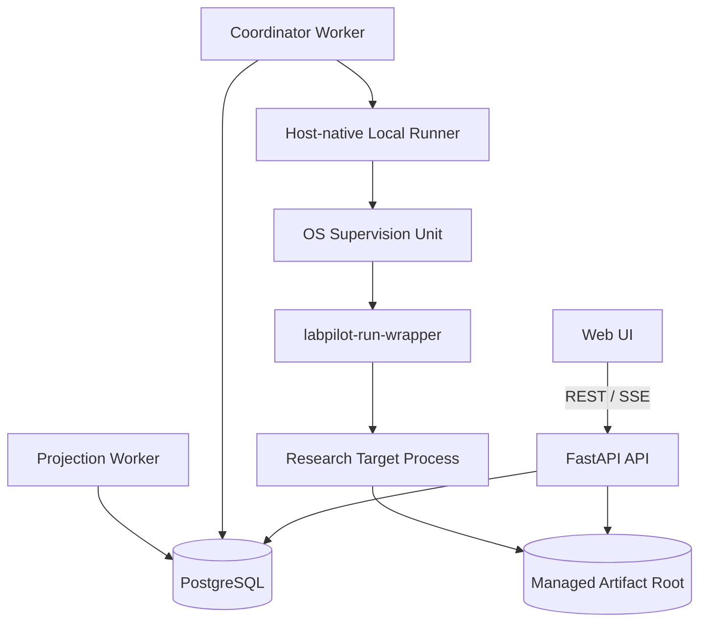
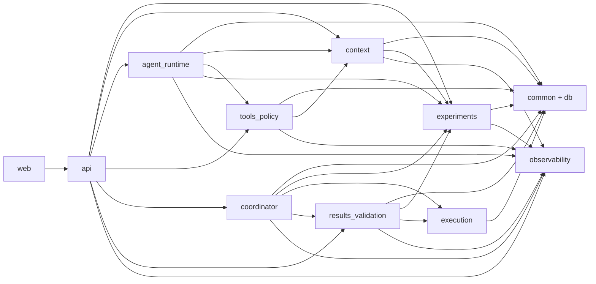

# LabPilot 架构索引与实施依赖图

```text
版本：v0.2
状态：Approved / Frozen
日期：2026-07-24
```

## 0. 文档目的

本文不是新的核心架构规格，不新增 `08` 号架构层，也不修改 `02–07` 的冻结语义。它承担三项实施治理职责：

1. 为实现者提供 `00–07` 的唯一导航入口；
2. 固定代码模块、运行进程、数据库所有权和依赖方向；
3. 将冻结架构映射为可独立验收的实施工作包。

发生冲突时，优先级为：

```text
01 V1 Scope / Acceptance
> 02–07 Frozen Architecture Contracts
> 本文
> Implementation Plans
> Code / Tests
```

实现发现冻结规格之间存在真实冲突时，必须暂停相关工作包并记录 Architecture Deviation；不得在代码中静默选择一种解释。

---

## 1. 冻结文档清单

| 层级 | 文件 | SHA-256 | 实施职责 |
|---|---|---|---|
| 总蓝图 | `docs/labpilot/00-master-blueprint-v0.2.md` | `16f2c39bda46881bb2ea13975db15d914a3a420b04b9dd21d45ebe315674a6fa` | 产品定位、总体进程和技术栈 |
| 范围 | `docs/labpilot/01-v1-scope-and-acceptance-v0.2-frozen.md` | `7092a034a78e6ea8b9f13533521fbaa6989ad15a0a25686057a75f286e33dbd6` | P0/P1、四条 Core Demo、NFR |
| 领域 | `docs/labpilot/architecture/02-experiment-domain-v0.2-frozen.md` | `2c998e7814a116c0999b21b6cf078dacb0fb6f770c929062480dc8ee98df328a` | Proposal、Version、Batch、Trial、Attempt |
| Agent | `docs/labpilot/architecture/03-agent-harness-v0.2-frozen.md` | `fcf1996547f73bed1f07e91b34e7c91af871a7641076d43a3ec2d33482552231` | Run、Step、ModelCall、Decision、Wakeup |
| Context | `docs/labpilot/architecture/04-context-and-repository-v0.2-frozen.md` | `14c8746cfc68d7f94aeb178573d14b06daefa8b7f117a2cffa2f7368aa1ca4a2` | Repository Snapshot、Evidence、Context Snapshot |
| Tool | `docs/labpilot/architecture/05-tools-policy-and-workspace-v0.2-frozen.md` | `af66e2fedc4edff65c6afeed793b5ca4f296cfecb204fcd86e8c468cd2d9320c` | Tool、Policy、Approval、Tool Workspace |
| Workflow | `docs/labpilot/architecture/06-workflow-and-executors-v0.2-frozen.md` | `dec726bea36cbbb6047f361be6ae4a4f99434405aaf96427efaad4434bd83732` | Coordinator、Runner、Supervisor、Reconciliation |
| Result | `docs/labpilot/architecture/07-results-validation-and-agentops-v0.2-frozen.md` | `1fde1ecbc48250eaa854593b45ef3ee8e314392e716ea5613c7628c2e4b1480e` | Artifact、Metric、Validation、Summary、Trace |

每个实施工作包启动前必须执行：

```bash
./scripts/verify_architecture_dependencies.sh <dependency-manifest>
```

---

## 2. 技术基线

```text
Backend: Python 3.12 + FastAPI
Schema: Pydantic v2
ORM: SQLAlchemy 2.x async
Database: PostgreSQL 16+
Migration: Alembic
Worker: PostgreSQL-backed fixed workers
Frontend: React + TypeScript + Vite + TanStack Query
Streaming: Server-Sent Events
Tests: pytest + pytest-asyncio + PostgreSQL integration tests
Control Plane: Docker Compose
Local Execution: Linux host-native Runner
Formal Process Supervision: capability-gated OS supervision unit
P1 Remote Execution: fixed SSH Executor
```

首版明确不引入：

```text
Temporal
Celery / RabbitMQ / Kafka
Kubernetes / SLURM scheduler
general workflow DSL
event sourcing
vector database for Context
multi-agent society
multi-tenant SaaS
```

---

## 3. 运行进程



### 3.1 API Process

拥有：

- REST API；
- SSE 连接；
- 用户命令入口；
- 查询权威对象与投影；
- 不执行训练代码；
- 不直接持有长期 Workflow Lease。

### 3.2 Coordinator Worker

拥有：

- Durable `CoordinatorJob`；
- Formal Workflow 推进；
- Attempt 创建请求；
- Result Processing 调度；
- 不直接 fork 训练进程；
- 不以 Python Future 作为状态真相。

### 3.3 Projection Worker

拥有：

- Outbox 投递；
- Timeline / Ops Projection；
- Projection Watermark；
- 失败可重建；
- 不恢复权威状态。

### 3.4 Local Runner

拥有：

- Executor 注册与 heartbeat；
- Prepare / Submit / Inspect / Cancel / Collect；
- Tool Lane 与 Formal Attempt Lane；
- 与 OS Supervision Backend 集成；
- 不拥有 Experiment Domain 状态。

### 3.5 OS Supervision Unit

拥有：

- process tree containment；
- durable timeout；
- cancel 和 kill entire execution group；
- wrapper exit fail-stop；
- queryable supervision identity。

---

## 4. 代码库目录基线

```text
LabPilot/
├─ pyproject.toml
├─ alembic.ini
├─ compose.yaml
├─ .env.example
├─ .github/
│  └─ workflows/ci.yml
├─ migrations/
│  ├─ env.py
│  ├─ script.py.mako
│  └─ versions/
├─ src/labpilot/
│  ├─ __init__.py
│  ├─ main.py
│  ├─ settings.py
│  ├─ api/
│  │  ├─ app.py
│  │  ├─ dependencies.py
│  │  ├─ errors.py
│  │  ├─ sse.py
│  │  └─ routers/
│  ├─ common/
│  │  ├─ canonical_json.py
│  │  ├─ clock.py
│  │  ├─ errors.py
│  │  ├─ hashing.py
│  │  ├─ ids.py
│  │  ├─ readiness.py
│  │  └─ types.py
│  ├─ db/
│  │  ├─ base.py
│  │  ├─ session.py
│  │  ├─ uow.py
│  │  └─ locks.py
│  ├─ experiments/
│  │  ├─ domain.py
│  │  ├─ commands.py
│  │  ├─ models.py
│  │  ├─ repository.py
│  │  └─ service.py
│  ├─ context/
│  │  ├─ repository_models.py
│  │  ├─ inspection.py
│  │  ├─ compiler.py
│  │  ├─ policy.py
│  │  └─ service.py
│  ├─ agent_runtime/
│  │  ├─ models.py
│  │  ├─ provider.py
│  │  ├─ runtime.py
│  │  ├─ budget.py
│  │  ├─ wakeups.py
│  │  └─ service.py
│  ├─ tools_policy/
│  │  ├─ registry.py
│  │  ├─ policy.py
│  │  ├─ approval.py
│  │  ├─ workspace.py
│  │  ├─ execution.py
│  │  └─ service.py
│  ├─ coordinator/
│  │  ├─ models.py
│  │  ├─ jobs.py
│  │  ├─ workflow.py
│  │  ├─ reconciliation.py
│  │  └─ worker.py
│  ├─ execution/
│  │  ├─ contracts.py
│  │  ├─ local_runner.py
│  │  ├─ supervision.py
│  │  ├─ wrapper.py
│  │  ├─ markers.py
│  │  └─ cli.py
│  ├─ results_validation/
│  │  ├─ artifacts.py
│  │  ├─ metrics.py
│  │  ├─ validation.py
│  │  ├─ summary.py
│  │  ├─ processing.py
│  │  └─ service.py
│  └─ observability/
│     ├─ events.py
│     ├─ outbox.py
│     ├─ projections.py
│     ├─ projection_worker.py
│     └─ queries.py
├─ web/
│  ├─ package.json
│  ├─ vite.config.ts
│  └─ src/
├─ tests/
│  ├─ unit/
│  ├─ integration/
│  ├─ fault_injection/
│  ├─ e2e/
│  └─ fixtures/
└─ scripts/
   ├─ verify_architecture_dependencies.sh
   ├─ wait_for_postgres.py
   └─ run_core_demo.sh
```

### 4.1 目录规则

- 每个模块拥有自己的 SQLAlchemy Rows、Repository 和 Application Service；
- `coordinator/worker.py` 与 `observability/projection_worker.py` 是进程入口，不形成独立业务模块，也不改变所在模块的表所有权和依赖方向；
- `api` 只能调用 Application Service，不能直接操作其他模块表；
- `coordinator` 通过命令调用 `experiments`、`execution` 和 `results_validation`；
- `execution` 不 import `api`、`agent_runtime` 或 Web 类型；
- `common` 不 import 任何业务模块；
- `observability` 可以消费事件，但不能成为业务模块的状态恢复依赖；
- 跨模块共享的稳定值对象进入 `common`，领域枚举仍保留在所属模块。

---

## 5. 模块依赖方向



禁止依赖：

```text
experiments -> agent_runtime
experiments -> coordinator
experiments -> execution
execution -> coordinator
execution -> results_validation
results_validation -> coordinator
observability -> authority services
```

### 5.1 实施期内部依赖 Allowlist

WP0 必须把本节转换成可执行的 Architecture Test。任何 `labpilot.<target>` 内部 import 若未在来源模块的允许集合中出现，都必须失败；不得只维护少量已知反向依赖黑名单。

```text
common             -> common
db                 -> common, db
observability      -> common, db, observability
experiments        -> common, db, observability, experiments
context            -> common, db, observability, experiments, context
tools_policy       -> common, db, observability, context, tools_policy
agent_runtime      -> common, db, observability, experiments, context, tools_policy, agent_runtime
execution          -> common, db, observability, execution
results_validation -> common, db, observability, experiments, execution, results_validation
coordinator        -> common, db, observability, experiments, execution, results_validation, coordinator
api                -> common, db, observability, experiments, context, tools_policy, agent_runtime, execution, results_validation, coordinator, api
```

相对导入必须解析为所属顶层模块；`TYPE_CHECKING`、多 alias import 和包内所有 `.py` 文件均在检查范围内。测试代码豁免必须在测试配置中显式列出，不能通过跳过解析实现。

---

## 6. 数据所有权

| 模块 | 拥有的权威表族 | 不得直接修改 |
|---|---|---|
| experiments | project、experiment、proposal、version、batch、trial、attempt、validation selection | AgentRun、ToolCall、Workflow、Artifact |
| context | repository registration/snapshot/evidence、policy revision、context snapshot | Proposal、Attempt、Tool Approval |
| agent_runtime | agent run/step/model call/decision/wakeup | Experiment Version、Trial、Attempt |
| tools_policy | tool definition/availability、policy manifest、approval、tool intent/attempt/workspace | Formal Attempt、Batch |
| coordinator | workflow、coordinator jobs、executor jobs、reconciliation case | Trial/Attempt 状态事实；只能调用 Domain Service |
| execution | executor registration、host plan、workspace、marker observation、supervision observation | Trial eligibility、Summary |
| results_validation | processing root/revision、artifact、metric、validation run/report、summary revision | Attempt execution status |
| observability | runtime event、outbox、projection、watermark | 所有权威业务行 |

---

## 7. 事务边界

### 7.1 权威事务模板

```text
lock authority aggregate
→ validate current state and generation
→ update authority rows
→ allocate aggregate event sequence
→ insert immutable RuntimeEvent
→ insert OutboxRecord(event_id)
→ commit
```

### 7.2 外部副作用模板

```text
persist immutable intent/plan
→ commit
→ perform external action
→ persist observation/result
→ reconcile on uncertainty
```

### 7.3 文件系统发布模板

```text
persist publish intent
→ stage / verify / fsync / atomic publish
→ persist authority object
→ reconcile orphan or missing file
```

PostgreSQL 事务不得伪装成可以与进程、Git、文件系统或 Provider API 形成分布式原子提交。

---

## 8. 同步接口与异步接口

### 8.1 同步 Application Commands

- 创建 Project / Repository Registration；
- 捕获 Repository Snapshot；
- 启动 Agent Run；
- 提交 Tool Approval Decision；
- 提交 Design Approval；
- 创建 Formal Workflow；
- 请求 Cancel；
- 查询权威状态。

同步命令只确认“意图已经被权威地接受”，不等待训练、模型调用或结果处理完成。

### 8.2 Durable Jobs

- Agent Wakeup；
- Coordinator Job；
- Attempt Executor Job；
- Result Processing Job；
- Projection Job；
- Reconciliation Job。

每个 Job 必须具有：

```text
stable dedupe key
generation-fenced lease
run_at
attempt count
last error
terminal disposition
```

---

## 9. 实施工作包

### WP0：工程底座与事务基础

交付：

- Python/FastAPI 项目；
- PostgreSQL + Alembic；
- async Unit of Work；
- Canonical JSON V1；
- RuntimeEvent + Outbox；
- Docker Compose；
- CI。

退出门槛：架构依赖校验、空库 migration、`/health/live`、`/health/ready`、严格单事务 UoW、PostgreSQL integration test、完整 RuntimeEvent/Outbox 原子与并发序列测试全部通过。

### WP1：Project、Repository Context 与 Experiment Domain

交付：

- Project / Repository Registration；
- clean/dirty Snapshot；
- deterministic inspection；
- Project Policy Revision；
- Context Snapshot；
- Proposal / Version / Batch / Trial / Attempt 核心领域。

退出门槛：在无 LLM 和无 Runner 情况下，可以通过 API 构造一个冻结 Version 并展开确定 Trial。

### WP2：Agent Harness、Tool Policy 与双审批

交付：

- bounded Agent Run；
- Model Request Snapshot；
- single-action Decision；
- deterministic verifier；
- Tool Registry / Manifest；
- Tool Approval；
- synthetic Red Tool Demo。

退出门槛：Demo D 自动化测试通过，未经批准副作用次数为 0。

### WP3：Formal Workflow、Local Runner 与恢复

交付：

- durable workflow；
- coordinator jobs；
- Attempt Host Plan；
- Local Runner；
- supervision backend；
- wrapper/marker protocol；
- cancellation/timeout/reconciliation。

退出门槛：Demo B 的受控崩溃窗口通过，相同 token 的目标进程创建次数为 1。

### WP4：Artifact、Metric、Validation、Summary 与 AgentOps

交付：

- managed Artifact；
- deterministic Metric extraction；
- Validation Input/Report；
- first-eligible selection；
- deterministic Summary；
- Runtime Timeline 和查询投影。

退出门槛：Demo C 通过；执行成功但缺失 Artifact 被判定 invalid，且不进入 Summary。

### WP5：Web UI 与 V1 Core Demo

交付：

- Project / Repository UI；
- Agent / Proposal / Approval UI；
- Workflow / Attempt / Result UI；
- SSE Timeline；
- 四条 Core Demo 自动化和展示脚本；
- Docker Compose 完整部署。

退出门槛：Demo A–D 全部通过，V1 Core Release 可宣布完成。

### WP6：P1 差异化

按价值排序：

1. SSH Executor；
2. Result Interpretation / Follow-up Proposal；
3. Worktree；
4. LLM Semantic Verifier；
5. 成本统计和增强 Timeline。

WP6 不阻塞 V1 Core。

---

## 10. 关键路径

```text
WP0
→ WP1
→ WP2
→ WP3
→ WP4
→ WP5
```

允许的有限并行：

- WP1 后端稳定后，可以开始 Web 的 Project/Repository 页面壳；
- WP3 开发期间，可以并行准备测试科研仓库和故障注入脚本；
- WP4 开发期间，可以并行制作 Timeline UI；
- 领域/执行接口未冻结前，不并行实现其下游 Worker。

---

## 11. 测试金字塔

### 11.1 Unit

- Canonicalization；
- 状态机；
- identity；
- policy；
- summary numerics；
- evidence matrix。

### 11.2 PostgreSQL Integration

- 行锁；
- partial unique index；
- lease generation；
- job claim；
- event/outbox 原子性；
- first-eligible 并发；
- approval/expiration 竞争。

### 11.3 Host Integration

- marker durability；
- process identity；
- supervision fail-stop；
- timeout/cancel；
- source/dataset/environment recheck；
- artifact atomic publish。

### 11.4 Fault Injection

- API/Coordinator/Runner crash；
- Provider response lost；
- Tool side effect unknown；
- wrapper death；
- filesystem publish/DB commit split；
- projection worker failure。

### 11.5 Core E2E

Demo A–D 是发布门槛，而不是手工演示脚本替代测试。

---

## 12. 实施治理

每个任务必须遵循：

```text
write failing test
→ verify expected failure
→ implement minimum behavior
→ run focused tests
→ run affected integration tests
→ commit one coherent change
```

禁止：

- 为“以后可能需要”提前实现 P1；
- 用 SQLite 替代 PostgreSQL 并发测试；
- 在 Router 中实现领域逻辑；
- 在 Worker 中直接 update 其他模块表；
- 通过 UI 状态推断权威状态；
- 因测试困难而删除 unknown/reconciliation 分支；
- 用单一 happy-path E2E 替代故障注入。

---

## 13. 当前实施入口

当前首先执行：

```text
docs/superpowers/plans/
2026-07-24-labpilot-phase-0-foundation.md
```

当前执行版本为 `v0.2 / Ready for Execution`。其目标是建立后续所有模块可以依赖、且不需要返工的工程和事务底座。
