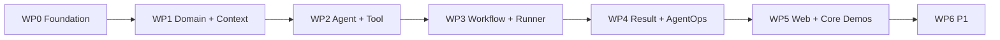

# LabPilot Implementation Roadmap

```text
版本：v0.2.1
状态：Approved / Frozen
日期：2026-07-24
```

## 0. 目标

本路线图把冻结的 `00–07` 文档转换为六个 V1 Core 工作包（WP0–WP5）和一个 P1 差异化工作包（WP6）；每个工作包都可单独评审、测试和回滚。它不是代码级计划；每个工作包开始前，必须生成对应的 `docs/superpowers/plans/` 详细计划，并使用当时已经存在的接口与文件路径，避免一次性为整个系统猜测实现细节。

---

## 1. 里程碑

| 里程碑 | 工作包 | 用户可见结果 | 发布含义 |
|---|---|---|---|
| M0 Foundation Ready | WP0 | API/DB/Worker 底座可运行 | 可以安全开始领域实现 |
| M1 Domain Ready | WP1 | Project→Version→Trials 可确定性完成 | 领域主链成立 |
| M2 Controlled Agent Ready | WP2 | Agent 生成 Proposal，Tool Approval 可验证 | 受控 Agent 决策成立 |
| M3 Local Execution Ready | WP3 | 真实训练可提交、取消、恢复 | Core Alpha |
| M4 Result Plane Ready | WP4 | Artifact→Validation→Summary 可追溯 | Demo C 可通过 |
| M5 V1 Core | WP5 | Web + Demo A–D 全通过 | V1 Core Release |
| M6 Differentiated | WP6 | SSH / Interpretation 等 | V1 Differentiated/Polished |

---

## 2. 工作包顺序



顺序依据不是文档编号，而是接口依赖：

- Agent 必须消费已经存在的 Context 和 Proposal Service；
- Workflow 必须消费已经存在的 Version、Trial、Attempt 和 Approval；
- Result Plane 必须消费 terminal Attempt 和 Collection Manifest；
- Web UI 必须消费稳定 API，而不是反向定义领域模型。

---

## 3. WP0：工程底座与事务基础

### 范围

- Architecture Dependency Guard；
- Python 3.12 package；
- FastAPI app factory；
- Pydantic Settings；
- PostgreSQL 16；
- SQLAlchemy 2 async；
- Alembic；
- 严格一次性单事务 Unit of Work；
- Canonical JSON V1 与资源边界；
- 完整 RuntimeEvent/Outbox Envelope、原子事务与并发序列；
- 模块依赖 Allowlist；
- one-shot Migration Service；
- `/health/live` 与 `/health/ready`；
- Docker Compose；
- GitHub Actions。

### 不做

- 任何完整业务聚合；
- Agent Provider；
- Runner；
- Web 前端；
- P1 依赖。

### 退出门槛

```text
architecture dependency verification passes before implementation
fresh database migration passes through the one-shot migrate service
/health/live and /health/ready pass
strict UnitOfWork lifecycle tests pass
PostgreSQL row-lock capability test passes
RuntimeEvent + Outbox atomic, replay, and concurrent sequence tests pass
module dependency allowlist test passes
process shells start and stop cleanly on SIGTERM
CI passes from clean checkout
```

详细计划：

```text
docs/superpowers/plans/2026-07-24-labpilot-phase-0-foundation-v0.3-ready-for-execution.md
```

---

## 4. WP1：Project、Repository Context 与 Experiment Domain

### 子阶段

#### WP1-A Project / Repository

- Project；
- RepositoryRegistration；
- Root identity；
- clean/dirty RepositorySnapshot；
- Freshness Projection；
- deterministic inspection；
- Evidence。

#### WP1-B Policy / Context

- ProjectResearchContextRevision；
- ProjectPolicyRoot/Revision；
- ContextSourceBinding；
- deterministic Context Compiler；
- Context Snapshot / Freshness。

#### WP1-C Experiment Domain

- Proposal Root/Revision；
- verifier records；
- Design Approval；
- Experiment Version identity；
- Batch expansion；
- Trial condition hash；
- Attempt active unique index；
- Trial projections；
- rerun authorization。

### 退出门槛

从 API 完成：

```text
create project
→ register repository
→ capture clean snapshot
→ record inspection evidence
→ create proposal revision
→ pass deterministic verifier
→ approve revision
→ freeze version
→ create formal batch
→ expand exact trials
```

不得依赖 LLM、Runner 或 Web UI。

### 计划生成门槛

只有 WP0 的 `main` 分支通过 migration、UoW 和 event/outbox 测试后，才生成 WP1 详细计划。该计划必须读取实际的 `src/labpilot/db` 和 `observability` 接口，不预设现在尚不存在的类型签名。

---

## 5. WP2：Agent Harness、Tool Policy 与双审批

### 子阶段

#### WP2-A Agent Runtime

- AgentRun / Lease / Wakeup；
- AgentStep；
- ModelRequestSnapshot；
- ModelCall retry；
- single-action Decision；
- bounded budget；
- no-progress。

#### WP2-B Proposal Verifier

- schema verifier；
- deterministic verifier；
- rule verifier；
- Proposal repair cycle。

#### WP2-C Tool / Policy

- ToolDefinition / Availability；
- Available/Exposed Manifest；
- Constraint Set；
- ExecutionTrustGrant；
- ToolExecutionPlan；
- Approval；
- Intent/Attempt；
- synthetic Red Demo。

### 退出门槛

- 无效多动作模型响应不执行任何 Tool；
- Approval expiration/cancel transaction race 测试通过；
- Tool 参数变化使 Approval 失效；
- Demo D 中未经批准的副作用执行次数严格为 0；
- Agent 只能产生 Proposal Revision，不能直接创建 Version。

---

## 6. WP3：Formal Workflow、Local Runner 与恢复

### 子阶段

#### WP3-A Durable Coordinator

- FormalExperimentWorkflow；
- CoordinatorJob；
- generation-fenced claim；
- workflow cancellation；
- needs_attention。

#### WP3-B Formal Host Plan

- AttemptExecutionRequest；
- AttemptHostExecutionPlan；
- Source/Dataset/Environment Binding；
- Workspace identity；
- filesystem capability probe。

#### WP3-C Local Runner

- ExecutorRegistration；
- Runner Job claim；
- Supervision backend；
- wrapper；
- marker protocol；
- inspect/cancel/timeout。

#### WP3-D Reconciliation

- Evidence Matrix；
- process identity；
- reboot / PID reuse；
- target_started no-relaunch；
- unresolved closure。

### 退出门槛

Demo B 通过：

```text
runner dies after target_started
→ target launch count remains 1
→ new runner reconciles original process
→ workflow resumes
```

如果宿主机没有满足 Supervision Capability，Formal Runner 必须 fail closed；不得以普通 subprocess 模式伪装成已经满足冻结契约。

---

## 7. WP4：Result Plane、Validation、Summary 与 AgentOps

### 子阶段

#### WP4-A Result Handoff / Artifact

- ResultProcessingRoot/Revision；
- logical run / execution attempt；
- ArtifactPublishIntent；
- managed copy；
- Availability / Retention Hold。

#### WP4-B Metric / Validation

- built-in Extractor；
- MetricObservation；
- ValidationInputSnapshot；
- missing/corrupted facts；
- ValidationReport；
- first-eligible；
- authoritative revalidation。

#### WP4-C Summary

- SummaryInputSnapshot；
- SummaryNumericsV1；
- group aggregation；
- Summary Revision；
- invalidation。

#### WP4-D AgentOps

- RuntimeEvent projection；
- Agent/Workflow/Trial Timeline；
- Ops projections；
- SSE；
- projection lag/watermark。

### 退出门槛

Demo C 通过，并能从 Summary 数值反向定位：

```text
Summary Aggregate
→ MetricObservation
→ metric_source Artifact
→ selected ValidationReport
→ Attempt
→ Trial
→ Experiment Version
```

---

## 8. WP5：Web UI 与 V1 Core Release

### 页面范围

- Projects；
- Repository Snapshot / Inspection；
- Agent Run；
- Proposal Revision / Design Approval；
- Tool Approval；
- Batch / Trial / Attempt；
- Logs / Timeline；
- Artifact / Validation / Summary；
- needs_attention / unresolved execution。

### UI 原则

- 权威状态与 Timeline Projection 分开显示；
- Projection lag 可见；
- 不允许由前端合成领域状态；
- 高风险审批显示绑定参数哈希和 Preconditions；
- invalid 与 failed 使用不同视觉语义；
- unknown 永远不能显示成普通失败或完成。

### 退出门槛

Demo A–D：

- 自动化 E2E 全通过；
- 可录制求职展示；
- Docker Compose 控制面 + Host Runner 的安装说明可重复执行；
- 从空库 migration 后可以完成完整演示。

---

## 9. WP6：P1 优先级

### P1-1 SSH Executor

首先实现，因为它最能体现 LabPilot 与普通本地脚本管理器的差异。

### P1-2 Result Interpretation

只读取指定 Summary Revision 和 Evidence，生成 Interpretation Proposal，不修改权威科研事实。

### P1-3 Worktree

改善 dirty repository / 并行实验体验，但不改变 Frozen Source Snapshot 语义。

### P1-4 LLM Semantic Verifier

在确定性和规则验证之后运行，不成为 P0 依赖。

### P1-5 Cost / Enhanced Timeline

最后实现，避免在核心可靠性未完成前优化展示指标。

---

## 10. 发布门槛

### Core Alpha

```text
WP0 + WP1 + WP2 + WP3 基本 happy path
```

允许暂时没有完整 Web UI，但必须运行真实科研命令。

### V1 Core

```text
WP0–WP5
+ Demo A–D
+ fault injection
+ PostgreSQL integration
+ clean deployment replay
```

### V1 Differentiated

```text
V1 Core + real SSH recovery demo
```

---

## 11. 计划治理

每个工作包的详细计划必须：

- 使用实际存在的文件路径；
- 给出接口签名；
- 先写失败测试；
- 给出精确命令和预期失败/成功；
- 每个 Task 形成可独立 review 的 commit；
- 映射对应 Frozen Invariant；
- 明确不实现的相邻范围；
- 在结尾提供 fault injection 或 acceptance gate。

禁止一次性生成 WP1–WP5 的全部代码级计划，因为：

1. WP0 会锁定 Session/UoW/Event 接口；
2. WP1 会锁定 Domain Service 和 DB 模型；
3. 下游计划必须消费实际接口，而不是提前猜测；
4. 过早计划会制造大量路径、类型和迁移编号漂移。

因此本阶段的正确输出是：

```text
总架构索引
+ 主路线图
+ WP0 可执行详细计划
```
